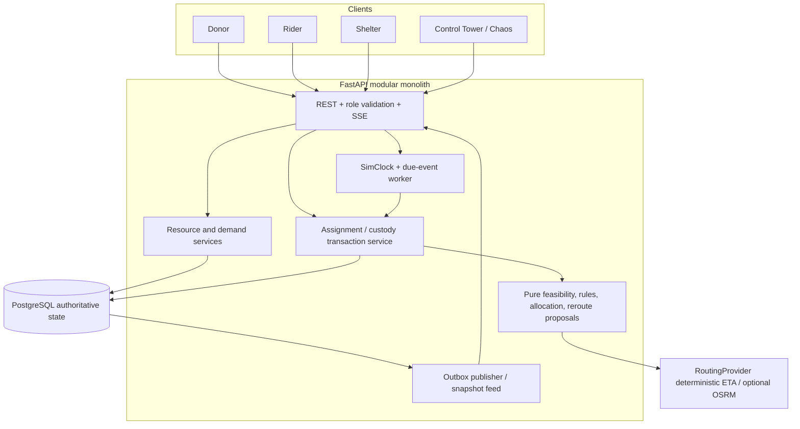
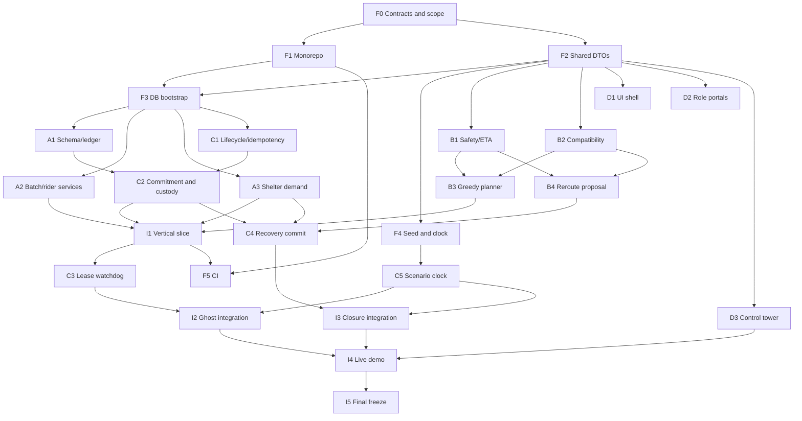

# ZeroSpoil — Unified Master Architecture & Multi-Agent Implementation Plan

> **Version:** 2.0 — 23 October 2026  
> **Purpose:** Authoritative architecture, implementation specification, GitHub issue backlog, coding-agent handoff, integration runbook, failure-test strategy, and demo guide.  
> **Status:** **Planning document, not a claim that anything is implemented or verified.**  
> **Working name:** ZeroSpoil (replaceable).  
> **Official challenge:** *The Last-Mile Spoilage Trap: Coordinating Perishable Surplus & Fragile Aid Under Uncertainty.*

**One-line product:** A deadline-aware aid-dispatch network that splits perishable donations into deliverable lots, safely leases them to volunteers, detects failed commitments early, and re-plans live when destinations or riders change.

**Non-negotiable engineering principle:** **Safety, quantity conservation, and consistency are enforced by the backend transactionally.** Maps, AI, dashboards, and notifications cannot override them.

## How to use this document

1. **All teammates read §§0–6** before starting. These sections define the project's requirements, exact stack, domain contracts, and rules.
2. The integration lead builds and merges the **foundation gate (§13, F0–F5)** before independent feature branches are integrated. Agents may start pure algorithms and mocked UI earlier.
3. Each teammate owns one workstream in **§12** and assigns GitHub issues from **§14** to separate subagents/worktrees.
4. Every subagent uses the exact shared types, endpoints, file boundaries, and completion template in **§15**.
5. Integrate a working donor → lot → lease → pickup → delivery slice **before** attempting advanced optimization (§16).
6. Rehearse the judge-triggered failures in **§17** and measure reliability using **§18**.
7. **A mock frontend does not constitute implementation of a backend feature.** Likewise, a sophisticated optimizer that never commits assignments correctly does not count as delivered functionality.

**Document precedence:** Official hackathon problem statement and marking scheme > this unified plan > archived ideation playbook > individual agent assumptions. Any incompatible contract change requires a reviewed architecture decision record (ADR).

---

# 0. Decisions at a glance

| Decision | Locked hackathon choice | Why |
|---|---|---|
| Architecture | **Modular monolith**, separated domain/services, not microservices | Independent agents without distributed deployment burden |
| Frontend | **React + TypeScript + Vite + Tailwind + shadcn/ui** | Strong demo UX; reusable components; parallel frontend work |
| Backend | **Python 3.12+ + FastAPI + Pydantic v2** | Fast API delivery; simulation/testing; Python-first OR-Tools extension |
| Database | **PostgreSQL** via SQLAlchemy 2 + Alembic | Atomic multi-row updates and accurate concurrency tests |
| Geospatial | Lat/lon + deterministic `RoutingProvider`; PostGIS if time | No dependency on a live routing API in judging |
| Real time | **SSE** initially; WebSocket only if bidirectional push needed | Server-to-client state events are enough for MVP |
| Matching | **Deterministic greedy feasibility-first** | Fast, explainable, testable; CP-SAT is an optional upgrade |
| Reservation | **One active lease per lot**; standby offers are nonbinding | Avoid contradictory double-pickup semantics |
| Clock | Dependency-injected real/simulated clock + deterministic due-event scheduler | Time-warp and judge failure injection work reproducibly |
| Concurrency | Database transactions, row locks, versions, unique indexes, idempotency | Required even for small demos |
| Background jobs | **Database-backed due-work scheduler**, one worker initially | Durable work with no required Redis dependency |
| Later queue scale | Redis + RQ/arq/Celery or equivalent, with DB outbox | Useful only after correct baseline |
| Deployment | Docker Compose + local/reproducible demo | Reliable startup and continuous GitHub commits |
| AI/LLM | Optional convenience only, **not** eligibility/safety authority | Unsafe to hallucinate compatibility or expiry |
| Scope cutoff | P0 single pickup → single destination per lot; one-destination reroute | Multi-drop and relay require extra custody/accounting logic |

**Repository note:** The earlier implementation draft proposed a TypeScript/Fastify backend. This unified plan deliberately chooses **Python/FastAPI** because the ZeroSpoil playbook's clock, Hypothesis, and optional OR-Tools design fits Python, while **keeping the earlier plan's simpler transactional architecture and React/TypeScript UI**. Do not maintain two backend implementations.

## 0.1 Official marking scheme — how implementation supports it

| Criterion | Weight | Concrete evidence judges should be able to inspect |
|---|---:|---|
| Functionality & execution | 30% | Real operations, safe split assignments, automatic ghost recovery, dynamic reroute, no double claims |
| UI/UX polish | 20% | Crisp control tower; distinct role flows; actual live changing states; understandable failures |
| Solution feasibility | 20% | Transparent safety assumptions, transactional ledgers, no unnecessary production promises |
| Innovation & creativity | 15% | Adaptive feasibility leases, proactive fallback scoring, explainable decisions, chaos/digital-twin demo |
| Live demonstration | 15% | One-click time warp, custom failures, observable event audit, recoverable reset, seeded scenarios |

The PDF specifically names: tight expiry, splitting across several riders, unresponsive volunteers, and shelter demand closing during transit. Those are **P0 release gates**. Compatibility/safety also follows from the mission, even if it is not repeated in the testing sentence.

## 0.2 What we will *not* promise

- No claim of literally **zero spoilage in the physical world**; the software prevents knowingly unsafe dispatch and flags unrecoverable situations.
- No claim that a simplistic Haversine-speed ETA is statistically a **P90** estimate. Label it *conservative estimated ETA* unless calibrated data exist.
- No claim that mocked GPS, inferred temperature, or donor text independently prove food or medicine safety.
- No invented capacity, load-test, precision, solver-optimality, or live deployment benchmarks.
- No automatic offline authorization to drop goods at a previously cached shelter: fallback candidates must be revalidated.
- No live medical distribution at scale without appropriate licenses and domain review. The prototype demonstrates rules using fixtures.

---

# 1. Problem, users, and the core demonstration

## 1.1 Problem in operational terms

Perishable aid fails not because a donor or shelter doesn't exist, but because **the network makes promises that stop being feasible**: a donor has 180 meals with 75 minutes left; scooters carry 40; shelter demand is smaller or changes; a volunteer claims then disappears; and some items require water, fuel, refrigeration, or qualified receivers.

ZeroSpoil must solve four *coupled* constraints:

1. **Capacity:** split batches into properly sized independent lots without creating or losing units.
2. **Deadlines:** never issue/pick up/route a lot based on travel time that makes timely delivery infeasible.
3. **Liveness:** leases end and inventory is released if a rider is unresponsive *before* rescue becomes impossible.
4. **Destination suitability:** respect current demand and verified handling requirements; re-evaluate after material changes.

## 1.2 Actors and permissions

| Actor | Can do | Cannot do |
|---|---|---|
| Donor | Create batch, declare ready/handling time, see pickup states, cancel available stock | Force expiry extension or mark delivery complete |
| Rider | View eligible offers, accept one, signal movement/heartbeat, pickup, report stuck, deliver | Claim same lot twice, steal active custody, override safety gate |
| Shelter | Create/update item-specific demand; record walk-ins; confirm or reject deliveries; change capabilities | Falsify another shelter's state |
| Coordinator | Observe all, inspect audit, intervene safely, resolve exceptions | Override nonnegotiable safety requirements |
| Judge (demo role) | Trigger isolated chaos events and advance simulated time | Modify real-world production records |

MVP authentication may use seeded demo accounts and roles, but **backend authorization checks must exist**. Never rely on a hidden frontend button as access control.

## 1.3 Primary vertical slice

```text
Donor creates 180 meals, safe_by = T+75m
  → backend computes deliver_by after configured service buffer
  → dispatch generates several candidate rider/shelter lots
  → transaction reserves batch quantity and destination capacity
  → rider accepts an offer / receives exclusive lease
  → rider scans pickup (revalidates feasibility + quantity)
  → delivery is in transit (custody moves to rider)
  → shelter confirms quantities (or records closure/walk-in)
  → transaction updates counts, lot state, audit + outbox
  → dashboard shows correct totals and explanations
```

One disruption is added after the slice works: **rider goes silent**, then **destination closes**. Both must trigger actual backend behavior, not animation-only state.

## 1.4 Success criteria and exclusions

**P0:** create batch; calculate deadlines; inspect feasibility; plan/split; reserve and accept atomically; pickup; deliver; account for quantities; expire/reassign no-show lease; close demand/walk-in and trigger reroute or clearly logged exception; apply three hard compatibility examples; control tower/time warp; continuous meaningful commits; scenario tests.

**P1:** pre-computed ranked fallback candidates, rider reliability ranking, signed pickup QR, destination ack, PostGIS, CP-SAT comparison, richer maps/UI, property tests and short load sweeps.

**P2:** two-stop partial reroute, multi-trip, relay custody, hedged *standby* offers, live routing provider, Redis jobs, multilingual intake, micro-hubs, telemetry, advanced notifications, predictive ML.

---

# 2. Architecture and scaling boundary

## 2.1 Logical architecture



**Ownership rule:** Pure engines (`domain/`, `engines/`) return **proposals and reason codes**; only transactional service functions write authoritative stock/demand/custody state. API route handlers never implement quantity mathematics independently.

## 2.2 Five executable boundaries

1. **Web:** React static frontend. Talks to API through a generated typed client.
2. **API:** Stateless-ish FastAPI process serving REST and an SSE event stream; no essential jobs executed as fragile fire-and-forget request tasks.
3. **Worker:** Separate small process polling due work/outbox in PostgreSQL; can initially run as a single container/process.
4. **Database:** PostgreSQL with a single schema and Alembic-managed migrations; source of truth for inventory, leases, delivery, event audit.
5. **Adapters:** Routing, clock, optional notification and cache providers; fake versions make judging deterministic.

Do not build separately deployed resource, dispatch, leasing, and UI-backend microservices during the sprint. Logical modularity is not the same thing as network-level microservices.

## 2.3 Optional production evolution

```text
MVP: Web → FastAPI → Postgres; one worker; SSE
Scale 1: add Redis-backed queue, PostGIS, ETA cache, separately scaled workers
Scale 2: more API/worker replicas + load balancer + shared SSE distribution
Scale 3: read replicas, DB tuning/partitioned audit, queue metrics, autoscaling
Scale 4: geo-partitioning / cross-zone coordination after real load evidence
```

**Kafka, Kubernetes, distributed locks, and full microservices are not prerequisites.** Add them only for a measured problem with an explicit operational owner.

## 2.4 Redis's *actual* role when introduced

Redis may speed up **ephemeral heartbeats, transient rider positions, queue delivery, ETA memoization, and cross-instance event fan-out**. It must not become a second authority on donated quantity or shelter demand. Queued/delayed jobs **always revalidate state and time in PostgreSQL**. Never use Redis key expiry as the only source of truth for lease expiration.

## 2.5 Where concurrency exists

Concurrent HTTP requests, overlapping worker jobs, retries, delivery confirmations, walk-in shelter updates, and lease-expiry checks all touch shared state. The database must serialize **conflicting entity transitions**, without globally serializing unrelated deliveries.

---

# 3. Key innovations — functional, explainable, defensible

## I1. Feasibility-protected adaptive leases (P0)

An accepted offer is an exclusive **short-lived promise**. Its deadline is constrained by remaining safe travel, current rider ETA, and an opportunity for reassignment. Heartbeat loss is *suspicion*, not proof of failure; feasibility loss is a hard reason to revoke **unpicked-up** goods. Picked-up cargo is **never** returned to donor inventory by a lease watchdog.

**Judge observable:** force rider silent; clock advances; `SUSPECT` → `LEASE_REVOKED` → stock safely reoffered with an event reason.

## I2. Recovery-aware dispatch (P0 basic; P1 advanced)

The planner ranks valid destinations using conservative ETA, remaining safe slack, and available alternative destinations. A fallback is a **candidate list**, not guaranteed reserved capacity. On closure, engine revalidates and makes a transactional new commitment if feasible; otherwise raises an explicit at-risk exception.

**Judge observable:** shelter fills mid-transit → rider destination changes, or coordinator sees a truthful partial/unrecoverable alert.

## I3. Explainable hard safety rules (P0)

Compatibility conditions are reusable and testable: `RAW_RATION_KIT` needs water + cooking fuel/facility; formula requires appropriate safe water/handling and authorized context; cold-chain medicine needs suitable equipment and qualified receiver. Dietary allergies are **hard constraints** when declared, not optimization penalties.

**Judge observable:** blocked matching with exact reason codes; alternate candidate if available.

## I4. Controlled logistics digital twin (P0)

Single-seeded demo scenario plus `SimClock`, controllable GPS/ETAs, chaos actions, invariants and event timeline. The same domain code runs in simulation and real time. Demonstrate *actual state transitions* rather than a video or UI-only mock.

## I5. Optional measurable optimization (P1/P2)

Use an explainable greedy baseline first. Optionally compare to CP-SAT on fixed inputs; report only measured changes in safe deliverable quantity, computation time, or reroute success. Do not call a simple heuristic globally optimal.

---

# 4. Domain language, lifecycle, and invariants

## 4.1 Core terms

| Name | Meaning |
|---|---|
| Batch | Original donor donation and physical total quantity in one item class |
| Lot | A discrete physical allocation belonging to a batch, with a unique custody lifecycle |
| Offer | Nonbinding rider notification: multiple riders can see it, no pickup rights |
| Lease | Exclusive time-limited accepted claim for one unpicked-up lot |
| Assignment | Committed route/rider/destination for a specific lot |
| Demand | Shelter's need for a particular item class and service window |
| Demand commitment | Quantity reserved or in transit toward one demand row |
| Safe-by | Product/handling safety cutoff, governed by explicit policy + donor declaration |
| Deliver-by | `safe_by - receiving/serving_buffer`; earlier than expiry |
| ETA | Estimated travel time from routing adapter; not a validated percentile by default |
| Slack | Time available after conservative travel + handover or transfer |
| Fallback | Candidate destination requiring revalidation before becoming an assignment |
| Custody | Whose physical control goods are currently under: donor, rider, destination, or discard |
| Event | Append-only record of an important domain decision or transition |
| Scenario | Isolated simulated environment; no chaos actions against production |

## 4.2 Exact quantity conservation

For each batch at any committed database state:

```text
batch.total_qty =
    available_at_donor_qty
  + reserved_at_donor_qty
  + carried_by_riders_qty
  + delivered_confirmed_qty
  + disposed_or_rejected_qty
```

These five amounts represent **mutually exclusive physical states**. Sum must always equal the original total and each must be nonnegative. `planned`, `offered`, and `fallback` are not additional physical buckets; avoid double-counting them. If a rider loads 35 of an assigned 40, atomically move 35 from reserved to carried and 5 from reserved to available (or disposed if physically unsafe) with a new audit event.

For quantities allocated to lots, do not assert `sum(lot.qty) == batch.qty` when some stock is unallocated: either retain an explicit unallocated balance or model the entire physical stock in nonoverlapping lots and aggregate their status. This plan uses **authoritative batch balances plus lot custody quantities**, checked by reconciliation queries.

## 4.3 Item-specific shelter ledger

For each `(shelter, item_class, service_window)` demand:

```text
uncommitted_need = max(0,
    required_qty
    - received_confirmed_qty
    - reserved_for_pickup_qty
    - in_transit_committed_qty
)
```

- Offers are not reserved.
- On confirmed commitment/lease, add to `reserved_for_pickup`.
- On pickup, shift `reserved_for_pickup → in_transit_committed`.
- On delivery, shift `in_transit_committed → received_confirmed`.
- On pre-pickup cancellation, decrement `reserved_for_pickup` and release physical reservation.
- On safe reroute, decrement old destination's transit commitment and increment new destination's transit commitment **inside one transaction**.
- A walk-in donation increments received, perhaps causing `received + committed > required`. Do **not** drop or falsify already delivered goods: mark overcommitment and trigger recovery for remaining incoming lots.
- `intake_open=false` makes new assignments invalid regardless of positive demand.

**Required schema correction versus ideation v1:** One `needed` column on `shelters` cannot safely represent different categories, service windows, or reserved vs in-transit quantities.

## 4.4 Core invariants, with achievable wording

| ID | Guarantee enforced by code/tests | Reality caveat |
|---|---|---|
| INV-1 SAFETY | No **new** offer/accept/pickup/reroute commitment passes if estimated delivery misses deadline or hard compatibility fails | Real-world ETA/temperature uncertainty cannot be eliminated |
| INV-2 EXCLUSIVITY | At most one active pickup lease per lot and one active custody holder | Standby offers are not leases |
| INV-3 CONSERVATION | All batch quantity exists in exactly one physical bucket; demand commitments never silently duplicate | Physical loss must be explicitly recorded |
| INV-4 DEMAND | New committed allocations cannot exceed current uncommitted need | Walk-in events may legitimately cause temporary overcommitment to be recovered |
| INV-5 LIFECYCLE | Transitions follow versioned state machine; expired pre-pickup lots cannot be picked up | Late or stale requests receive an error, not an implicit override |
| INV-6 AUDIT | Every successful state transition persists an audit event in same DB transaction | Notification delivery occurs afterward and may retry |
| INV-7 RECOVERY | In-transit invalid destinations trigger reroute attempt or immediate recorded exception | A feasible alternative cannot always exist |
| INV-8 TIME | All authoritative deadlines use server-owned `Clock`, UTC timestamps, and consistent arithmetic | No reliance on client clocks |
| INV-9 AUTH | Actor roles and scenario isolation checked on server | Demo seed accounts only in demo mode |
| INV-10 IDEMPOTENCY | Retries with same key/payload return same effect; changed payload conflicts | Network retries may be duplicated |

Do not call `fallback_count >= 1` a physical invariant: sudden closure of *all* shelters makes it impossible. Treat fallback coverage as a **risk metric and alerting condition**.

## 4.5 Lot state machine

```mermaid
stateDiagram-v2
  [*] --> OPEN
  OPEN --> OFFERED: send offer
  OFFERED --> OPEN: offer expires
  OPEN --> LEASED: accepted reservation
  OFFERED --> LEASED: accepted reservation
  LEASED --> SUSPECT: missed progress / heartbeat
  SUSPECT --> LEASED: recovers, still feasible
  LEASED --> OPEN: revoke/release before pickup
  SUSPECT --> OPEN: revoke before pickup
  LEASED --> IN_TRANSIT: pickup and handover validated
  SUSPECT --> IN_TRANSIT: pickup valid after revalidation
  IN_TRANSIT --> REROUTING: destination invalid
  REROUTING --> IN_TRANSIT: alternate committed
  REROUTING --> AT_RISK: no valid destination
  AT_RISK --> IN_TRANSIT: new safe plan committed
  IN_TRANSIT --> DELIVERED: confirmed receipt
  OPEN --> EXPIRED: no safe pickup possible
  LEASED --> EXPIRED: revoked; goods expire at donor
  AT_RISK --> DISPOSED: documented safe disposal
  DELIVERED --> [*]
  EXPIRED --> [*]
  DISPOSED --> [*]
```



**Custody is distinct from routing state:** goods can be `IN_TRANSIT` and `AT_RISK` without returning physically to the donor. `EXPIRED` before pickup and `DISPOSED` after pickup must not release cargo to other riders. Invalid events must return `409 STATE_CONFLICT` without modifying balances. State-machine implementation may use explicit transition map rather than relying solely on this diagram.

---

# 5. Deadline, route, compatibility, and matching specification

## 5.1 Time model

Use timezone-aware UTC timestamps internally. A shared `Clock.now() -> datetime` is mandatory. Client-provided timestamps are observations, never authoritative lease deadlines. Simulation runs within a scenario namespace and uses a separate injected simulated time; elapsed monotonic scheduling is not inferred from browser timers.

**Policy-controlled deadline:**

```python
safe_by = min(
    donor_declared_safe_until,
    applicable_validated_policy_cap,   # if available; never invent a medical/food-safe default
    printed_expiry_if_applicable,
)
deliver_by = safe_by - receiving_buffer(item_class)
```

If safety-relevant evidence is absent or contradictory, **reject or require manual verified entry** rather than guessing an expiry. For hackathon seed data, explicit simulated `safe_by` values are acceptable; UI must identify them as scenario inputs. The class-specific timing values in the ideation document are **unverified prototype policy defaults**, not automatic legal safe-harbor rules.

**Pre-pickup feasibility:**

```text
now + eta(rider, donor) + handover_time + eta(donor, shelter)
    + handling_buffer <= deliver_by
```

**In-transit feasibility:**

```text
now + eta(rider_current_position, shelter) + required_dropoff_time
    <= deliver_by
```

**Latest arrival at donor:**

```text
latest_donor_arrival =
    deliver_by - handover_time - eta(donor, shelter) - handling_buffer
```

Then `slack_pre = latest_donor_arrival - [now + eta(rider, donor)]`. **Never subtract handover twice**; previous ideation text did that in one watchdog expression.

## 5.2 Adaptive lease deadline (corrected)

The goal is to revoke the promise early enough that another rider may still rescue the goods. Keep it simple and defensible:

```text
physical_deadline = latest_donor_arrival(original rider/destination)
raw_ttl          = min(10 min, max(0, 0.25 * positive_slack))
rescue_margin    = configured time for next offer/accept + replacement rider travel estimate
latest_lease_end = min(physical_deadline, deliver_by - route_to_shelter - handover - rescue_margin)
lease_expires_at = min(now + raw_ttl, latest_lease_end)
```

A more accurate implementation computes rescue margin using the **best feasible standby candidate**; if none exists, do not make a false rescue guarantee. If `lease_expires_at <= now`, **do not issue the lease**; escalate or reevaluate. There is intentionally **no unconditional 90-second lower bound**, because a smaller available slack must win. Conservative simplified TTL with a hard deadline cap is fine for MVP; write tests around the boundary.

Heartbeats every ~10s, `SUSPECT` after 2 missed, revoke after 4 missed, and first-progress deadline ~120s are **prototype configuration defaults** from the ideation playbook, not universally valid service guarantees. Offline connectivity alone should not prove malicious abandonment. Feasibility and custody are authoritative.

## 5.3 Pure matching pipeline

1. Snapshot eligible batch units, uncommitted shelter demand, rider capacities/locations, item requirements, and scenario clock.
2. Reject incompatible class/capability combinations before scoring.
3. Reject capacity zero, unavailable rider, shelter closed, and ETA-infeasible pairs.
4. Score feasible assignments by deliverable quantity, slack, travel cost, optional reliability, and diversity of fallback candidates.
5. Greedily choose the best candidate; decrement **local snapshot** of remaining capacity/demand/stock; produce a plan with reason explanations and unallocated remainder.
6. **Never commit inside this pure function.** Publishing proposals creates nonbinding offers; on rider acceptance the operations service obtains locks and rechecks changed rows/versions/time before actually reserving.
7. On snapshot conflict, rebuild the plan or return an explicit retryable conflict. Do not pretend stale proposals are current.

Example score, only after all hard filters pass:

```text
score = 1000 * safe_quantity
      + 2 * feasible_slack_minutes
      + 5 * fallback_candidate_count
      - 1 * estimated_route_minutes
      + small * rider_reliability
```

Weights are demonstrative tunables, not researched optimal constants. Fairness can be measured and added later; never optimize a soft score at the expense of safety.

## 5.4 Single-trip and multi-trip

**P0:** A rider has at most one active pickup/in-transit assignment. A `rider.active_assignment_id` or an occupancy table/constraint enforces exclusivity; choose one canonical owner. A single lot has one destination. Repeated trips occur only after a confirmed completed or released prior trip.

**P2:** Multi-trip solver must model return travel and non-overlapping time windows; `trip slot 2` must not be simultaneously active with trip 1. A pair of heuristic candidate slots alone does not enforce time/resource feasibility.

## 5.5 Reroute specification

Input: current lot state/quantity on board, location, original demand, candidate shelters, clock, compatible capabilities, ETA adapter. The engine outputs a proposed *new single destination*, or `NO_FEASIBLE_DESTINATION` with reasons. The transactions layer must lock current lot and both affected demand rows and reserve the new demand **atomically**. Do not mutate committed quantities during candidate scoring.

**Fallback candidates are advisory, not permanently reserved.** Recalculate them on close/walk-in/capability changes; revalidate during reroute. If 40 meals are carried and only one alternative has demand for 30, **P0 must not pretend all 40 have been delivered**. Show unmet 10 as an at-risk quantity and coordinator escalation, or require an alternative with ≥40 for single-stop reroute. P1 multi-drop can add 30+10 only with explicit stops and delivery accounting.

## 5.6 Rule engine contract

```python
@dataclass(frozen=True)
class CompatibilityDecision:
    allowed: bool
    hard_blocks: list[str]
    warnings: list[str]
    required_capabilities: list[str]
    evidence_checked_at: datetime | None
```

Initial P0 rules: `RAW_RATION_NEEDS_COOKING`, `POWDER_FORMULA_NEEDS_SAFE_HANDLING`, `COLD_CHAIN_NEEDS_VERIFIED_STORAGE`, `DIETARY_ALLERGEN_MUST_MATCH`. For regulated aid, require qualifying recipient / handling authorization. Unknown or stale required evidence fails closed. No agent can replace this deterministic check with an LLM answer.

## 5.7 Routing provider

```python
class RoutingProvider(Protocol):
    def eta_seconds(self, origin: Coordinates, destination: Coordinates,
                    scenario_id: UUID | None = None) -> int: ...
```

MVP returns deterministic estimates based on distance and a documented speed/road factor. Use seed-city fixtures with explicit reproducible ETA tables for scenario tests. Optional OSRM integration has a timeout and falls back to conservative simulated estimates **clearly marked as approximate**. If an estimate is too uncertain for a safety-critical real deployment, the system must not assert safety.

---
# 6. PostgreSQL schema and transactional consistency

## 6.1 Persistence rules

- **Single authoritative PostgreSQL database**. No mandatory SQLite 'lite' path: SQLite has materially different locking behavior and can conceal concurrency bugs.
- Alembic migrations are the only supported schema-change mechanism. Group A owns migrations. Other teams request schema changes through an ADR or issue comment.
- Use UUID primary keys for domain entities, UTC `timestamptz`, integer quantity with `CHECK (qty >= 0)`, indexes on due/active status, and unique indexes enforcing exclusivity.
- Store simulation-owned domain records with `scenario_id` (nullable for ordinary real time) and scope *every* demo query/write to a scenario. In P0, run only one active demo scenario at a time; add multi-tenant/multi-scenario support if time permits.
- Store audited events **in the same transaction** as state mutation; publish SSE after commit through outbox consumer.
- A single transaction may lock the relevant batch, lot, rider and demand rows; unrelated donations can progress concurrently.
- Quantities are integer item units (meals, packages, kits); do not mix units in the same demand. A `unit` column or canonical `item_class` maps units explicitly.

## 6.2 Proposed minimum tables

| Table | Responsibility | Important fields / constraints |
|---|---|---|
| `scenarios` | Live vs demo clock namespace | `id`, `name`, `mode`, `sim_now`, `active`, `version` |
| `users` | Seed identities and roles | `id`, `role`, `external_id`, `display_name` |
| `donors` | Donation locations | `id`, `user_id`, `latitude`, `longitude`, `verified` |
| `riders` | Capacity and availability | `id`, `user_id`, location, `capacity_units`, `status`, `version` |
| `shelters` | Receiving locations and capabilities | `id`, location, `intake_open`, `capabilities_json`, `verified_at`, `version` |
| `demands` | Need **per item class/time window** | `id`, `shelter_id`, `item_class`, `required`, `received`, `reserved`, `in_transit`, `version` |
| `batches` | Donation metadata | `id`, `donor_id`, `item_class`, `total_qty`, `safe_by`, `deliver_by`, `status`, `version` |
| `batch_inventory` | Canonical physical conservation | `batch_id`, `available`, `reserved`, `carried`, `delivered`, `disposed` |
| `lots` | Proposed subdivisions before acceptance; custodial lots afterward | `id`, `batch_id`, `qty`, `state`, `rider_id`, `version` |
| `offers` | Nonbinding candidate notifications and target demand | `id`, `lot_id`, `rider_id`, `demand_id`, `expires_at`, `status` |
| `assignments` | Active/done destination commitment | `id`, `lot_id`, `rider_id`, `demand_id`, `status`, `eta_sec`, `version` |
| `leases` | Exclusivity until pickup | `id`, `lot_id`, `rider_id`, `expires_at`, `first_progress_by`, `active`, `version` |
| `scheduled_actions` | Durable ghost/offer/reroute due work | `id`, `scenario_id`, `type`, `due_at`, `status`, `dedupe_key`, `attempts` |
| `events` | Append-only audit | `id`, `scenario_id`, `aggregate_id`, `type`, `reason_code`, `payload`, `occurred_at` |
| `outbox` | At-least-once event publication | `id`, `event_id`, `published_at`, `attempts` |
| `idempotency_records` | Safe retry response | `(actor_id, endpoint, key)` unique, `request_hash`, `response`, `status_code` |

**Optional:** `locations_history`, `capability_verifications`, `delivery_stops` (P1), `service_windows`, `notification_attempts`, `rider_reliability_stats`.

## 6.3 PostgreSQL reference DDL (illustrative, adapt in Alembic)

This is a **precise starting specification**, not an already executed migration. SQLAlchemy migrations must add all required FKs, scenario columns, and consistency checks before declaring foundation complete.

```sql
CREATE TABLE batches (
  id uuid PRIMARY KEY,
  scenario_id uuid,
  donor_id uuid NOT NULL,
  item_class text NOT NULL,
  total_qty integer NOT NULL CHECK(total_qty > 0),
  safe_by timestamptz NOT NULL,
  deliver_by timestamptz NOT NULL,
  status text NOT NULL DEFAULT 'OPEN',
  version bigint NOT NULL DEFAULT 0,
  CHECK(deliver_by <= safe_by)
);

CREATE TABLE batch_inventory (
  batch_id uuid PRIMARY KEY REFERENCES batches(id),
  available integer NOT NULL CHECK(available >= 0),
  reserved integer NOT NULL DEFAULT 0 CHECK(reserved >= 0),
  carried integer NOT NULL DEFAULT 0 CHECK(carried >= 0),
  delivered integer NOT NULL DEFAULT 0 CHECK(delivered >= 0),
  disposed integer NOT NULL DEFAULT 0 CHECK(disposed >= 0),
  version bigint NOT NULL DEFAULT 0
);
-- Transaction layer must assert: available+reserved+carried+delivered+disposed = batches.total_qty.

CREATE TABLE demands (
  id uuid PRIMARY KEY,
  scenario_id uuid,
  shelter_id uuid NOT NULL,
  item_class text NOT NULL,
  required_qty integer NOT NULL CHECK(required_qty >= 0),
  received_qty integer NOT NULL DEFAULT 0 CHECK(received_qty >= 0),
  reserved_qty integer NOT NULL DEFAULT 0 CHECK(reserved_qty >= 0),
  transit_qty integer NOT NULL DEFAULT 0 CHECK(transit_qty >= 0),
  service_from timestamptz,
  service_until timestamptz,
  status text NOT NULL DEFAULT 'OPEN',
  version bigint NOT NULL DEFAULT 0
);
CREATE INDEX demands_eligible_idx ON demands(item_class, status, shelter_id);

CREATE TABLE lots (
  id uuid PRIMARY KEY,
  scenario_id uuid,
  batch_id uuid NOT NULL REFERENCES batches(id),
  qty integer NOT NULL CHECK(qty > 0),
  state text NOT NULL,
  rider_id uuid,
  version bigint NOT NULL DEFAULT 0,
  created_at timestamptz NOT NULL,
  updated_at timestamptz NOT NULL
);
CREATE INDEX lots_batch_idx ON lots(batch_id);
CREATE INDEX lots_state_idx ON lots(state);

CREATE TABLE offers (
  id uuid PRIMARY KEY,
  lot_id uuid NOT NULL REFERENCES lots(id),
  rider_id uuid NOT NULL,
  demand_id uuid NOT NULL REFERENCES demands(id),
  status text NOT NULL DEFAULT 'OPEN',
  expires_at timestamptz NOT NULL,
  created_at timestamptz NOT NULL
);
CREATE INDEX offers_eligible_idx ON offers(rider_id, status, expires_at);

CREATE TABLE assignments (
  id uuid PRIMARY KEY,
  lot_id uuid NOT NULL REFERENCES lots(id),
  rider_id uuid NOT NULL,
  demand_id uuid NOT NULL REFERENCES demands(id),
  status text NOT NULL,
  eta_seconds integer NOT NULL CHECK(eta_seconds >= 0),
  created_at timestamptz NOT NULL,
  updated_at timestamptz NOT NULL,
  version bigint NOT NULL DEFAULT 0
);
CREATE UNIQUE INDEX one_active_assignment_per_lot
  ON assignments(lot_id)
  WHERE status IN ('RESERVED','IN_TRANSIT','REROUTING');
CREATE UNIQUE INDEX one_active_assignment_per_rider
  ON assignments(rider_id)
  WHERE status IN ('RESERVED','IN_TRANSIT','REROUTING');

CREATE TABLE leases (
  id uuid PRIMARY KEY,
  lot_id uuid NOT NULL REFERENCES lots(id),
  rider_id uuid NOT NULL,
  issued_at timestamptz NOT NULL,
  expires_at timestamptz NOT NULL,
  first_progress_by timestamptz NOT NULL,
  active boolean NOT NULL DEFAULT true,
  version bigint NOT NULL DEFAULT 0
);
CREATE UNIQUE INDEX one_active_lease_per_lot ON leases(lot_id) WHERE active;

CREATE TABLE events (
  id bigint GENERATED ALWAYS AS IDENTITY PRIMARY KEY,
  scenario_id uuid,
  actor_id uuid,
  aggregate_id uuid NOT NULL,
  type text NOT NULL,
  reason_code text,
  payload jsonb NOT NULL DEFAULT '{}'::jsonb,
  occurred_at timestamptz NOT NULL
);
CREATE INDEX events_scenario_timeline_idx ON events(scenario_id, id);

CREATE TABLE outbox (
  id bigint GENERATED ALWAYS AS IDENTITY PRIMARY KEY,
  event_id bigint NOT NULL UNIQUE REFERENCES events(id),
  published_at timestamptz,
  attempts integer NOT NULL DEFAULT 0,
  last_error text
);
CREATE INDEX outbox_unpublished_idx ON outbox(id) WHERE published_at IS NULL;

CREATE TABLE scheduled_actions (
  id uuid PRIMARY KEY,
  scenario_id uuid,
  action_type text NOT NULL,
  aggregate_id uuid NOT NULL,
  due_at timestamptz NOT NULL,
  status text NOT NULL DEFAULT 'PENDING',
  dedupe_key text NOT NULL UNIQUE,
  attempts integer NOT NULL DEFAULT 0,
  claimed_until timestamptz,
  payload jsonb NOT NULL DEFAULT '{}'::jsonb
);
CREATE INDEX scheduled_pending_due_idx
  ON scheduled_actions(due_at, id) WHERE status='PENDING';

CREATE TABLE idempotency_records (
  actor_id uuid NOT NULL,
  endpoint text NOT NULL,
  idempotency_key text NOT NULL,
  request_hash text NOT NULL,
  status_code integer,
  response jsonb,
  created_at timestamptz NOT NULL,
  PRIMARY KEY(actor_id, endpoint, idempotency_key)
);
```

**Schema refinement requirement:** Partial unique indexes above enforce one active assignment per rider for P0. Nonbinding offers live in the separate `offers` table and must not count as active assignments. If simultaneous live/demo simulations are allowed, partial indexes must account for scenario-safe rider identities (e.g. cloned seed actors per scenario).

## 6.4 Transaction protocols (do not scatter these across API handlers)

### TX-1: Publish nonbinding planned offers

```text
BEGIN
  verify plan references valid batch, rider and demand IDs
  recheck versions/deadline before publishing, and ensure total lots
    proposed in THIS plan <= current available batch quantity
  create OFFERED lot rows and associated eligible rider/demand offers
  DO NOT modify batch_inventory.available/reserved or demand commitments
  DO NOT create an active assignment or lease yet
  invalidate overlapping superseded OPEN offers when replacing an old plan
  write OFFER_PUBLISHED audit events + outbox records
COMMIT
```

Offers are **candidate notifications, not physical reservations**. A displayed offer may become unavailable when another offer is accepted; the accept API must recheck everything. Keeping `lots.qty` as proposed quantity before lease acceptance does **not** move physical stock out of `inventory.available`, and such lots are excluded from custody reconciliation. This avoids stock being held by riders who never accepted.

### TX-2: Accept an offer **and atomically reserve stock plus receiving capacity**

```text
BEGIN
  lock batch + batch_inventory, the offered lot, selected rider, target demand
    (use same documented global order in every service)
  verify active offer targets this rider and demand, and has not expired
  verify lot is OFFERED/OPEN, rider is free, versions still match
  recompute time and hard compatibility using server Clock and fresh data
  verify inventory.available >= lot.qty
  verify target uncommitted need >= lot.qty and shelter intake is open
  inventory.available -= qty; inventory.reserved += qty
  demand.reserved += qty
  create one active assignment, one active pickup lease
  change lot state to LEASED, increment version, expire competing offers
  schedule durable lease-expiry and first-progress jobs
  insert audit event + outbox row; persist idempotent response
COMMIT
```

Unique active-lease and one-active-assignment-per-rider indexes are **database backstops**, not substitutes for business validation. Concurrent losers get `409 LOT_ALREADY_LEASED` or `409 PLAN_STALE`/`CAPACITY_CHANGED`; they never reserve hidden duplicate stock. Re-plan from current state after a lost claim rather than pretending all displayed offers are guaranteed. If a coordinator wishes to pre-commit allocations instead, that would require a separate timeout protocol and is **out of P0 scope**.

### TX-3: Pickup vs watchdog race

Both `pickup` and `revoke` must acquire the **same lot/lease locks**, compare current version/state and operate atomically.

- **Pickup wins first:** move `reserved → carried` and demand `reserved → transit`, close lease, set `IN_TRANSIT`; later watchdog reads changed state and does **nothing**.
- **Watchdog wins first:** close lease, release `reserved → available` and demand commitment, set `OPEN`/`EXPIRED` as appropriate; late pickup returns `409 LEASE_INVALID` and cannot claim custody.

Never infer rider custody from a heartbeat or receipt of a notification.

### TX-4: Shelter walk-in / close

- Lock shelter and the affected item-specific demands.
- Apply walk-in received quantity or intake status change, increment versions, append event/outbox.
- Mark related in-transit/reserved commitments for revalidation and enqueue deduplicated recovery work. **Do not globally block the request while a solver runs.**
- Preserve committed physical and demand quantities; report overcommitment as a recoverable fact, not a negative available stock bug.

### TX-5: Reroute

- Compute candidate *outside* transaction using a read snapshot.
- Acquire locks of lot, old assignment/demand and proposed new demand in stable order.
- Ensure cargo is truly `IN_TRANSIT`, new shelter is open/compatible/has enough demand, ETA still meets deadline, and no incompatible newer reroute exists.
- Move demand `transit` commitment old → new atomically; change assignment destination/version; append audit/outbox; release locks promptly.
- On conflict, discard stale proposal and retry with fresh snapshot, bounded attempts. On no safe match, persist `AT_RISK` plus coordinator alert.

### TX-6: Delivery confirmation

- Verify authenticated rider, active custody and appropriate shelter receipt confirmation policy.
- Move `inventory.carried → delivered` and `demand.transit → received` once.
- Finalize assignment and lot, release rider occupancy; emit one event.
- Duplicate idempotency request returns the same success; conflicting duplicate payload returns `409 IDEMPOTENCY_MISMATCH`.

## 6.5 Idempotency details

- Require `Idempotency-Key` for all client mutation endpoints and worker event actions that can be retried.
- Store a canonical hash of action + actor + route + normalized payload; key is scoped to actor and endpoint.
- Perform idempotency claim and domain transaction atomically when possible. Under duplicate in-flight keys, unique index contention/wait must resolve to one committed result; avoid treating an uncommitted placeholder as successful.
- Retain enough records for the operational lifecycle; `24h` is a configurable policy, not a hard guarantee when donations can last longer.
- Include `resource_version` / `expected_version` on client state-changing operations with stale-request rejection.

## 6.6 Outbox and SSE

A domain service creates an event and an outbox row in the same DB transaction. A lightweight publisher polls unpublished rows, sends notification to an in-process subscriber (MVP) and marks publish success. If publisher crashes after send but before marking, **duplicate event delivery is allowed**; consumers deduplicate by monotonically increasing `event.id`.

For a single API instance use SSE directly. After multiple instances are added, provide a shared pub/sub mechanism or have each connection reconcile using the persisted event cursor. Clients reconnect with `Last-Event-ID` or fetch a fresh snapshot and then events; never rely on an in-memory feed to reconstruct authoritative state.

**`FOR UPDATE SKIP LOCKED` belongs in queue/outbox worker selection**, not as a way to silently skip locked shelter demand during user allocations.

---

# 7. API contracts — freeze before parallel development

## 7.1 Conventions

- Prefix all routes `/api/v1`.
- JSON request/response schemas generated from Pydantic; TypeScript API client generated or validated against OpenAPI.
- Dates in ISO 8601 UTC. Quantities integer. Coordinates WGS84 latitude/longitude. Distances meters, durations seconds. **No unnamed time units.**
- Errors use `{ error: { code, message, details?, retryable? }, request_id }` with suitable status.
- All mutations require authenticated actor, authorized role, `Idempotency-Key`, and a scenario ID in demo mode.
- Include `version` in resource responses; incompatible stale writes return `409`.
- Demo endpoints additionally require `DEMO_MODE=true` and a coordinator/judge role.
- API operations must use shared service functions. A route may not directly write inventory balances.

## 7.2 Shared Pydantic DTOs / TypeScript equivalents

```json
{
  "batch_id": "uuid",
  "item_class": "HOT_COOKED_MEAL",
  "total_qty": 180,
  "available_qty": 20,
  "reserved_qty": 40,
  "carried_qty": 80,
  "delivered_qty": 40,
  "disposed_qty": 0,
  "safe_by": "2026-10-23T14:15:00Z",
  "deliver_by": "2026-10-23T14:05:00Z",
  "version": 8
}
```

The example is arithmetically consistent: `20 + 40 + 80 + 40 + 0 = 180`.

```json
{
  "demand_id": "uuid",
  "shelter_id": "uuid",
  "item_class": "HOT_COOKED_MEAL",
  "required_qty": 50,
  "received_qty": 10,
  "reserved_qty": 20,
  "transit_qty": 15,
  "uncommitted_need": 5,
  "intake_open": true,
  "version": 4
}
```

For events:

```json
{
  "id": 1038,
  "scenario_id": "uuid",
  "type": "LEASE_REVOKED",
  "aggregate_type": "lot",
  "aggregate_id": "uuid",
  "occurred_at": "2026-10-23T13:17:25Z",
  "reason_code": "NO_PROGRESS",
  "payload": { "previous_state": "SUSPECT", "new_state": "OPEN", "qty": 40 }
}
```

## 7.3 Endpoint inventory

| Method + route | Role | Behavior / authoritative write |
|---|---|---|
| `POST /batches` | Donor | Create batch and inventory balance; optionally preview feasibility |
| `GET /batches/{id}` | Donor/coord | Read balances, lots, deadline |
| `POST /dispatch/preview` | Coordinator/donor | Pure candidate plan, no commitments |
| `POST /dispatch/commit` | Coordinator | Publish bounded **nonbinding offers**; acceptance later reserves stock and demand |
| `GET /offers` | Rider | Compatible nonbinding offers |
| `POST /lots/{id}/accept` | Rider | Acquire exclusive lease atomically |
| `POST /lots/{id}/heartbeat` | Rider | Update progress hint without changing custody |
| `POST /lots/{id}/release` | Rider | Release unpicked-up lot safely |
| `POST /lots/{id}/pickup` | Rider/donor confirm | Handover gate; move reserved to carried |
| `POST /lots/{id}/report-stuck` | Rider | Refresh feasibility/recovery risk |
| `POST /lots/{id}/deliver` | Rider/shelter confirm | Confirm delivery once; move carried to delivered |
| `POST /demands` | Shelter | Item-specific requirement creation |
| `PATCH /demands/{id}` | Shelter | Revise requirement; revalidate commitments |
| `POST /shelters/{id}/events` | Shelter | Walk-in, close, reopen, capability change |
| `GET /control/state` | Coordinator/judge | Consistent operational snapshot |
| `GET /control/events` | Coordinator/judge | Paginated audit timeline |
| `GET /events/stream` | Authenticated clients | SSE, event IDs, reconnect |
| `POST /demo/scenarios/reset` | Judge/coord | Reload known fixture into isolated scenario |
| `POST /demo/clock/advance` | Judge/coord | Advance simulated time and run due actions |
| `POST /demo/chaos/rider-silent` | Judge/coord | Stop simulated heartbeat/progress for rider |
| `POST /demo/chaos/shelter-close` | Judge/coord | Invoke same shelter-change domain service |
| `POST /demo/chaos/walkin` | Judge/coord | Record externally received aid + reroute checks |
| `POST /demo/chaos/traffic` | Judge/coord | Change scenario routing factor and reevaluate |
| `POST /demo/chaos/capability-loss` | Judge/coord | Invalidate resource prerequisite and reevaluate |
| `GET /health/live` | Public/lightly gated | Process responding |
| `GET /health/ready` | Internal | DB reachable, migration compatible, worker status separately visible |

**Prefer `POST /lots/{id}/pickup` to `pickup-scan` for P0** so the demo can work with a click. P1 signed QR is an added proof mechanism rather than a forced dependency for the core state machine.

## 7.4 Concrete requests / responses

**Create batch:**

```http
POST /api/v1/batches
Idempotency-Key: create-batch-demo-001
Content-Type: application/json

{
  "scenario_id": "SCENARIO_UUID",
  "donor_id": "DONOR_UUID",
  "item_class": "HOT_COOKED_MEAL",
  "qty": 180,
  "ready_at": "2026-10-23T13:00:00Z",
  "declared_safe_by": "2026-10-23T14:15:00Z",
  "serving_buffer_seconds": 600
}
```

Response `201` provides batch ID, calculated `deliver_by`, balance, warnings and preview summary; never invent medical safety confidence.

**Dispatch preview:**

```json
{
  "batch_id": "BATCH_UUID",
  "base_batch_version": 0,
  "strategy": "GREEDY_FEASIBILITY_FIRST",
  "proposals": [
    { "rider_id": "R1", "demand_id": "A", "qty": 40, "eta_total_sec": 1140,
      "slack_seconds": 2760, "fallback_shelter_ids": ["D"] }
  ],
  "planned_qty": 40,
  "unallocated_qty": 140,
  "rejections": [{ "code": "INSUFFICIENT_CAPACITY", "count": 2 }]
}
```

The sample is schematic, **not** a claim the full batch has been solved; full fixture plans should contain all chosen proposals. Commit returns `200` with exact assignments or `409 PLAN_STALE` if source versions or time have changed.

**Accept lease:**

```http
POST /api/v1/lots/LOT_UUID/accept
Idempotency-Key: rider-r1-accept-001

{"rider_id":"RIDER_UUID","expected_version":3}
```

```json
{
  "lot_id":"LOT_UUID", "state":"LEASED", "version":4,
  "lease_id":"LEASE_UUID", "lease_expires_at":"2026-10-23T13:04:30Z",
  "first_progress_by":"2026-10-23T13:03:00Z"
}
```

**Shelter walk-in (including live recovery):**

```http
POST /api/v1/shelters/SHELTER_UUID/events
Idempotency-Key: walkin-a-50

{"type":"WALKIN_RECEIVED","demand_id":"DEMAND_UUID","qty":50}
```

Response returns new demand snapshot and `recovery_scheduled` IDs. Recovery may be asynchronous but must produce a visible event and complete within the defined demo target when worker runs.

**Error examples:** `400 INVALID_QUANTITY`, `403 FORBIDDEN_ROLE`, `404 NOT_FOUND`, `409 LOT_ALREADY_LEASED`, `409 PLAN_STALE`, `409 LEASE_INVALID`, `409 DEMAND_CAPACITY_CHANGED`, `409 IDEMPOTENCY_MISMATCH`, `422 SAFETY_BLOCKED`, `503 ROUTING_UNAVAILABLE` if no safe fallback estimate allowed.

## 7.5 Contracts and ownership freeze

- Group A owns persistent models, migration, DTO definitions and `/batches`, `/demands`, `/shelters` resource APIs.
- Group B owns **pure** planners/rules/routing modules. Request/response DTOs are agreed in foundation; it may not secretly add DB writes.
- Group C owns `/lots/*` lifecycle, idempotency, scheduler, event stream, and recovery commitment service.
- Group D owns React pages/components, generated client wrapper, mock server fixtures, demo command surfaces.
- Integrator owns `main.py`, `app bootstrap`, Compose, cross-group versioning, main integration tests, shared configuration, and merged contracts.

---

# 8. Scheduler, ghost detection, and simulator correctness

## 8.1 Why a durable scheduler

A simple `asyncio.sleep` in an HTTP handler loses state on process restart and won't follow an accelerated simulated clock. Instead, maintain `scheduled_actions` in PostgreSQL and process due work through a worker with an injected clock. Scheduled actions include lease expiry, first-progress deadlines, offer timeout, retry dispatch and pending recovery.

### Worker loop sketch

```python
async def run_due_jobs(now: datetime, limit: int = 100):
    # Use DB row locking/lease of pending jobs to avoid duplicate workers.
    jobs = await repo.claim_due_jobs(now=now, limit=limit)
    for job in jobs:
        try:
            await handlers[job.action_type](job, now=now)
            await repo.mark_job_done(job.id)
        except RetryableError:
            await repo.reschedule_with_backoff(job.id)
        except Exception as exc:
            await repo.record_failure_and_alert(job.id, exc)
```

The handler must be **idempotent** and recheck lot/version/lease state. A job created before pickup must do nothing if pickup already succeeded.

## 8.2 The watchdog logic

For each unpicked-up active lease, evaluate:

1. `now >= expires_at` → revoke (unless pickup already committed).
2. `now >= first_progress_by` and no sufficient progress signal → revoke or flag according to policy.
3. Missed heartbeats → `SUSPECT`, then revoke only after configured grace and state recheck.
4. `now + ETA(rider→donor) + handover + ETA(donor→destination) > deliver_by` → no longer feasible; revoke and seek substitute **before pickup**.

For in-transit lots, **never** return physical stock to donor because the rider stops responding. Mark `LOCATION_STALE`/`AT_RISK`, notify coordinator and attempt recovery when safely possible.

## 8.3 SimClock execution semantics

`POST /demo/clock/advance { seconds: 900 }` does **not** merely change a displayed timestamp. It must:

1. Lock or serialize advancement for that demo scenario.
2. Determine target time = scenario current time + delta.
3. Find the earliest due action with `due_at <= target`.
4. Set effective clock to that action's due time; execute all actions due at that point in deterministic `(due_at, id)` order.
5. Repeat until no due action remains within the target.
6. Set final scenario time to target and recompute risk displays.
7. Emit event stream updates, invariant report, and simulated-clock change.

A worker should not simultaneously process simulated jobs using real wall time. Restrict one active advancement at a time per scenario. Avoid endless loops by bounding actions and detecting repeated rescheduling at the same timestamp.

**Time-dependent math** must not use `datetime.now()` directly anywhere in domain code or transactional business logic; use injected `Clock`. Time warp must not affect unrelated real-time records.

## 8.4 Demo chaos adapter

The Chaos Console controls *world state*, not database balances directly. Examples:

- **Kill rider:** stop scenario heartbeat/progress generation; lease's scheduled checks run as time advances.
- **Jam traffic:** increase scenario route ETA for a defined corridor and force feasibility reevaluation.
- **Walk-in:** call the same `WALKIN_RECEIVED` resource service used by shelter portal.
- **Close shelter:** call the same intake-close service and enqueue recovery.
- **Remove water:** set capability to false and invalidate affected compatibility checks.
- **Reset:** replace the scenario fixture in a DB transaction or recreate namespace; reject reset while an advance is actively executing.

Chaos actions are disabled outside explicit demo mode and are not generally exposed to donor/rider roles.

---

# 9. Frontend UX and design specification

## 9.1 Four screens sharing a single design language

**Donor:** create a donation in under ~30 seconds with explicit item class/quantity/deadline; preview feasible vs unallocated quantity; clear pickup/expiry warnings. No claim that form entry establishes safety by itself.

**Rider:** one large active assignment at a time; deadline/slack, pickup and destination, accept/release, pickup/deliver, 'I'm stuck'; reason for reassignment; lightweight map/route indicator.

**Shelter:** item-specific demands; accepting toggle; verified capabilities; one-tap walk-in count; incoming commitments, confirm/reject delivery, inspect impact of a sudden closure.

**Control tower:** map/list hybrid, live lots, status counts, destination constraints, timeline, **Chaos Console**, simulated clock controls, recovery decision explanations and invariant health.

## 9.2 Required real-time UI states

`OPEN`, `OFFERED`, `LEASED`, `SUSPECT`, `IN_TRANSIT`, `REROUTING`, `AT_RISK`, `DELIVERED`, `EXPIRED`, `DISPOSED`. Every state must map to a readable label, timestamp and reason code. Warning colors must never be the only carrier of meaning.

## 9.3 Design choices

- Light mode, high contrast, simple sans-serif typography; one distinctive accent (teal/blue) with functional amber/red/green statuses.
- Consistent cards, restrained motion, good spacing, responsive split-pane layout.
- Use hero metrics: **safe delivered**, **live at-risk units**, **unallocated safe units**, **active ghost recovery**, **median recovery time** where measured.
- Live map is helpful but **must not be a dependency for a functioning demo**. Support a mapless/table fallback.
- Use seeded geographic points; do not imply map animation is real GPS tracking.
- Show one-line decision explanations: `LEASE_REVOKED · NO_PROGRESS · 40 units released`; `REROUTED · SHELTER_CLOSED · 26 min safe slack`.
- Make the critical judging flow visible without hidden navigation or page refresh.

## 9.4 SSE client protocol

1. Fetch `/control/state` snapshot with latest `event_id`.
2. Subscribe to `/events/stream?after=<event_id>`.
3. Apply new events idempotently by monotonically increasing IDs; if gap/restart/connection loss, re-fetch snapshot.
4. Show connection state `LIVE`, `RECONNECTING`, or `STALE`. Never imply a disconnected view is current.
5. Dashboard countdowns may render locally from server clock offset, but server remains authoritative for action eligibility.

## 9.5 Frontend test expectations

A Playwright smoke run must create a batch, preview dispatch, accept lease, pickup, close shelter, observe actual reroute/alert, confirm delivery (or controlled exception), and show an audit event. Keyboard/button access and loading/error states must work.

---

# 10. Repository layout and ownership boundaries

```text
zerospoil/
├── README.md
├── Makefile
├── docker-compose.yml
├── .env.example
├── .gitignore
├── .github/
│   ├── workflows/ci.yml
│   └── ISSUE_TEMPLATE/feature.md
├── docs/
│   ├── MASTER_IMPLEMENTATION_PLAN.md     # this document
│   ├── API_CONTRACT.md
│   ├── DATA_MODEL.md
│   ├── SAFETY_AND_LIMITATIONS.md
│   ├── ARCHITECTURE_DECISIONS.md
│   ├── GITHUB_ISSUES.md
│   ├── DEMO_SCRIPT.md
│   └── AGENT_HANDOFFS.md
├── backend/
│   ├── pyproject.toml
│   ├── alembic.ini
│   ├── alembic/versions/                 # Group A exclusively
│   ├── app/
│   │   ├── main.py                      # Integrator exclusively
│   │   ├── core/
│   │   │   ├── config.py                # Integrator
│   │   │   ├── clock.py                 # Foundation/Group C
│   │   │   ├── db.py                    # Foundation/Group A
│   │   │   ├── idempotency.py           # Group C
│   │   │   └── security.py              # Foundation
│   │   ├── contracts/
│   │   │   ├── requests.py              # Foundation, frozen
│   │   │   ├── responses.py             # Foundation, frozen
│   │   │   └── enums.py                 # Foundation, frozen
│   │   ├── domain/
│   │   │   ├── inventory.py             # Group A
│   │   │   ├── safety.py                # Group B
│   │   │   ├── rules.py                 # Group B
│   │   │   ├── eta.py                   # Group B
│   │   │   └── transitions.py           # Group C
│   │   ├── repositories/
│   │   │   ├── batches.py               # Group A
│   │   │   ├── demands.py               # Group A
│   │   │   ├── riders.py                # Group A
│   │   │   ├── lots.py                  # Group C
│   │   │   └── jobs.py                  # Group C
│   │   ├── engines/
│   │   │   ├── feasibility.py            # Group B
│   │   │   ├── planner_greedy.py         # Group B
│   │   │   ├── reroute.py                # Group B
│   │   │   ├── fallback.py               # Group B
│   │   │   └── planner_cpsat.py          # P1 optional Group B
│   │   ├── services/
│   │   │   ├── resources.py              # Group A
│   │   │   ├── commitment.py             # Group C
│   │   │   ├── lease.py                  # Group C
│   │   │   ├── custody.py                # Group C
│   │   │   ├── recovery.py               # Group C
│   │   │   └── events.py                 # Group C
│   │   ├── api/
│   │   │   ├── batches.py               # Group A
│   │   │   ├── shelters.py              # Group A
│   │   │   ├── riders.py                # Group A
│   │   │   ├── dispatch.py              # Integrator binds B + C
│   │   │   ├── lots.py                  # Group C
│   │   │   ├── control.py               # Group C
│   │   │   ├── demo.py                  # Group C
│   │   │   └── events.py                # Group C
│   │   ├── workers/
│   │   │   ├── scheduler.py             # Group C
│   │   │   └── outbox.py                # Group C
│   │   └── demo/
│   │       ├── scenarios.py             # Group C
│   │       └── seed.py                  # Foundation/Integrator
│   ├── tests/
│   │   ├── unit/
│   │   ├── integration/
│   │   ├── scenarios/
│   │   ├── concurrency/
│   │   └── properties/
│   └── rules/compatibility.yaml
├── web/
│   ├── package.json
│   ├── src/
│   │   ├── main.tsx
│   │   ├── generated/                    # generated from OpenAPI
│   │   ├── api/client.ts                 # Group D
│   │   ├── components/ui/               # Group D shared
│   │   ├── components/control/          # Group D control board
│   │   ├── features/donor/               # Group D
│   │   ├── features/rider/               # Group D
│   │   ├── features/shelter/             # Group D
│   │   ├── features/simulation/          # Group D
│   │   ├── hooks/useEventStream.ts       # Group D
│   │   └── mocks/                        # Group D contract fixtures
│   └── tests/e2e/
├── sim/
│   ├── seed_city.json
│   ├── judge_scenarios.py
│   ├── load_claims.py
│   └── load_dispatch.py
└── scripts/
    ├── check_contracts.sh
    ├── verify_integrated.sh
    └── generate_client.sh
```

This is a **target directory layout**. The foundation owner can simplify it, but any change must update issue ownership **before** agents begin modifying overlapping files. No subagent owns `main.py`, root Compose, or shared contracts after freeze.

---

# 11. Implementation skills and dependencies

## 11.1 Stack with installation intent

| Area | Selected | Why / caveat |
|---|---|---|
| Python API | FastAPI, Pydantic, Uvicorn | OpenAPI & docs, fast iteration |
| Persistence | SQLAlchemy 2, asyncpg or psycopg, Alembic | Pick **one** async/sync pattern; don't mix haphazardly |
| DB | PostgreSQL 16+ recommended | ACID, locking, partial indexes |
| Routing | Native deterministic adapter | Tests require fixed ETAs |
| Optional geospatial | PostGIS + geo indexes | No paid API requirement |
| Background processing | PostgreSQL due table and worker process | Reliable demo without another service |
| Optional optimization | Google OR-Tools `cp_model` | Only after greedy and core recovery work |
| Backend tests | pytest, pytest-asyncio, Hypothesis | Core invariants and races |
| UI | React, TypeScript, Vite | Strict shared API client |
| UI components | Tailwind + shadcn/ui | Consistent components, speed |
| Data fetching | TanStack Query | Cache invalidation + snapshot refresh |
| Maps | Leaflet or MapLibre, one chosen | Do not use both; table fallback |
| End-to-end | Playwright | Visible judge flows |
| DevOps | Docker Compose, GitHub Actions | Reproducibility and testable commits |
| Optional Redis | Redis + suitable Python queue | Add after measured contention/load |

## 11.2 Backend code conventions

- Python type hints throughout; avoid `Any` across domain boundaries.
- Domain algorithms pure and deterministic given inputs.
- Pydantic DTOs at API boundary, SQLAlchemy ORM models in persistence layer, dataclasses or typed domain records for planners.
- UTC-aware dates, integer seconds, positive integer quantities, normalized item classes.
- Service exceptions map to structured error codes; do not catch and silently ignore conflicts.
- No unbounded tasks spawned from HTTP requests; worker owns scheduled/retry work.
- Log request IDs, actor, scenario, event IDs, and reason codes without exposing private rider locations unnecessarily.

## 11.3 Frontend conventions

- Strict TypeScript; no parallel handwritten API shapes that contradict generated OpenAPI types.
- Organize by features; reusable visual components under `components/ui`.
- Accessible buttons, loading states, clear disabled actions and confirmation messages.
- UI never performs availability or safety validation as the sole enforcement point.
- Demo mock API must be replaceable by the real client without UI component rewrites.

---

# 12. Four parallel groups — team and subagent ownership

## Group A — Resources, persistence, and shelter ledger

**Teammate A coordinates:** database schema, migration, batch inventory, donors/riders/shelters, item-specific demands, walk-in events. Agents: A1 schema/migrations, A2 donors/riders/batches, A3 shelter demand/resource API, optionally A4 reconciliation. API mocks and interfaces frozen in F0–F5. **Does not own** lease or reroute transitions.

**Outputs:** persistent models, transaction-safe resource repository methods, seed data, inventory/demand snapshots and reconciliation tests.

## Group B — Pure dispatch intelligence

**Teammate B coordinates:** clock math, rules, routing adapter, feasibility filter, greedy splitter, fallback ranking and pure reroute proposals. Agents: B1 safety/ETA, B2 compatibility, B3 greedy planner, B4 recovery planner. All run initially on fixtures with no database dependency. **Does not own** table migrations, API route persistence, or assignment transactions.

**Outputs:** deterministic typed functions, explanation codes, unit tests and benchmark fixture input/output.

## Group C — Concurrency, lifecycle, real-time operations

**Teammate C coordinates:** versions/idempotency, lease state machine, pickup/delivery, durable scheduler, transactional assignment commits, recovery commits, events/SSE, demo time warp. Agents: C1 atomic leases, C2 custody/transaction service, C3 scheduler/SimClock, C4 outbox/SSE/chaos. Be careful: **C1 and C2 cannot both rewrite the same commitment service**; use separate modules with an integration owner.

**Outputs:** safe mutations, scheduled recovery, event feed, concurrency tests and scenario reset.

## Group D — User experience and demonstration

**Teammate D coordinates:** UI components, role portals, control tower/map, simulator controls, browser smoke tests. Agents: D1 shared UI/control tower shell, D2 donor/shelter pages, D3 rider page and live timeline, D4 simulation controls + Playwright. Use contract fixtures until APIs are available. **Does not own** FastAPI domain functions.

**Outputs:** production-style UI against actual endpoints, fallback for absent map tiles, meaningful loading/error states, demo script.

## Integration lead (must be explicitly assigned)

One human or agent lead owns repository foundations, frozen shared DTOs, cross-group merge gating, global config, `main.py`, Compose, CI, integration tests and final demo branch. They need not implement every module, but **must have authority to reject incompatible changes**.

## Example 12-agent layout

```text
                   Integration Lead / Architect
                             │
       ┌─────────────────────┼───────────────────────┐
       │                     │                       │
  Four coordinators:     A / B / C / D       Shared contract gate
       │
  A: A1 A2 A3          B: B1 B2 B3        C: C1 C2 C3        D: D1 D2 D3
  DB resources          pure algorithm    operations          UI + demo
       └──────────────────────┴───────────────────────┘
                     Verified group merges
                             │
                        End-to-end tests
```

**Important:** Three agents per group is a *maximum example*, not a mandatory quota. Assign agents only to tasks with disjoint file ownership and stable contracts. A coordinator may serialize two coupled issues inside their own group even while other groups run in parallel.

---
# 13. Foundation gate, decision log, and dependencies

The team may prototype algorithms and UI in parallel **before** the foundation gate, but no persistent service issue is 'ready to merge' until the corresponding shared contracts have been approved.

## 13.1 Mandatory foundation issues

### F0 — Scope and architecture freeze (integrator; P0)

**Files:** `docs/MASTER_IMPLEMENTATION_PLAN.md`, `docs/ARCHITECTURE_DECISIONS.md`, `docs/API_CONTRACT.md`.  
**Work:** Identify P0 flows, select final FastAPI/React/Postgres stack, decide one role/auth approach, one SQLAlchemy async/sync style, one map library, one canonical payload schema. Record which idealized source-playbook behaviors are P1/P2, not P0.  
**Done:** All four coordinators have acknowledged frozen contract names and file ownership. No contradictory backend language choice remains.  
**Dependency:** Official problem statement and this unified plan.

### F1 — Runnable monorepo skeleton (integrator; P0)

**Files:** root Compose, Makefile, `.env.example`, `backend/pyproject.toml`, `web/package.json`, skeleton `main.py`.  
**Work:** Install/run API, worker stub, DB, Vite and health checks; make a small first Git commit. Include `make up`, `make down`, `make test`, `make demo-reset`.  
**Done:** Clean clone and documented commands start services with a seeded scenario; endpoints `/health/live` and `/health/ready` behave sensibly.  
**Dependency:** F0.

### F2 — Shared DTOs and OpenAPI (integrator + Group A/C review; P0)

**Files:** `backend/app/contracts/*`, `docs/API_CONTRACT.md`, generated TS client directory.  
**Work:** Freeze item-class names, actor roles, status enums, event envelope, timestamp/quantity conventions, error responses and P0 endpoint payloads. Generate TypeScript types from OpenAPI.  
**Done:** One contract test verifies the sample batch/demand/event JSON; frontend mock fixtures compile with the generated types.  
**Dependency:** F0; can start before F1 is finished with static schema files.

### F3 — Database bootstrap (Group A with integrator review; P0)

**Files:** `core/db.py`, Alembic scaffold, initial migration.  
**Work:** Create PostgreSQL setup, connection/config, initial source-of-truth tables, constraints, indexes and transaction fixture.  
**Done:** `alembic upgrade head`, rollback/reinitialize and DB integration smoke pass. Schema and enum reconciliation with F2 is explicit.  
**Dependency:** F1, F2 contract review.

### F4 — Seed city and deterministic clock adapter (integrator + Group C; P0)

**Files:** `sim/seed_city.json`, `backend/app/demo/seed.py`, `core/clock.py`.  
**Work:** Create reproducible actors, 180-meal batch, several riders with 40 capacity, mixed shelter demand, compatible/incompatible classes, and an accessible alternate destination. RealClock and SimClock return UTC-aware time; deterministic ETA lookup fixture exists.  
**Done:** Reset always produces the same starting state, quantities, and routing estimates.  
**Dependency:** F2; persistence seeding waits for F3.

### F5 — CI and shared validation (integrator; P0)

**Files:** `.github/workflows/ci.yml`, `scripts/check_contracts.sh`, `scripts/verify_integrated.sh`, issue template.  
**Work:** Configure lint, typing if feasible, backend tests, web build, OpenAPI consistency; tests run against PostgreSQL service.  
**Done:** CI fails on a bad DTO drift or a broken migration, and pass status is visible in GitHub.  
**Dependency:** F1–F3.

## 13.2 Dependency graph



The arrows represent **hard integration dependencies**; pure unit implementation can start earlier using mocks. For example B1/B2/B3 and D1/D2 can run while A1 migrates the database.

## 13.3 Parallel execution waves (relative)

| Wave | Independently actionable | Merge/integration checkpoint |
|---|---|---|
| 0 | F0; preliminary UI wireframes; pure algorithm design | F0 contracts signed |
| 1 | F1/F2/F4 mock; B1/B2; D1/D2; A schema design | API & types compile |
| 2 | A1/A2/A3; B3/B4; C1; D3/D4 | Foundation DB migration and basic API works |
| 3 | C2, C3, C5, D5; integration vertical slice | **Real** create → allocate → pickup → deliver passes |
| 4 | C4/C6; reroute/ghost tests; polish UI | Failure scenarios pass through real backend |
| 5 | P1 optional enhancements if and only if P0 green | Feature freeze, load/concurrency smoke, demo rehearsal |

**Relative time allocation guidance:** Foundation/contracts 10%; parallel core 30%; first integration 20%; failure/recovery 20%; QA/UI/demo 20%. Adjust for actual available hours. Don't postpone the frontend until after the backend is finished.

---

# 14. GitHub issues — implementation-ready backlog

## 14.0 Issue format and universal acceptance requirements

Each issue body must contain:

1. **ID/title**, P0/P1/P2, owning group/coordinator/subagent.
2. **Exact file ownership** (allowed and prohibited paths).
3. **Inputs and outputs** using frozen contract names.
4. **Dependencies**, distinguishing hard blockers from mocks.
5. **Implementation steps and edge cases**.
6. **Tests to run and expected observable results**.
7. **Completion handoff**: commit SHA, test summary, changed files, assumptions, gaps, contract changes.

**Universal acceptance:** No writes outside assigned files; no breaking shared DTOs; no unreviewed new infrastructure; tests run; error paths handled; operations and audit remain consistent; proper branch/PR; new code merged by coordinator, not directly into main.

> Paste each individual issue below into GitHub, prefixed with `[P0][Group X]` and the ID. The content is deliberately specific, so it can also be supplied as an AI coding-agent task after adding the common preamble in §15.

## Group A issues

### A1 — Inventory and item-specific demand ledger [P0]

**Owner:** Group A / agent A1. **Files:** `backend/app/domain/inventory.py`, `backend/app/repositories/batches.py`, `backend/app/repositories/demands.py`, `backend/alembic/versions/*` (only A1 owns migrations), relevant unit/DB tests.  
**Depends on:** F2/F3. **Contract:** Batch inventory five-bucket conservation; demand `received/reserved/transit` state.  
**Implementation:** Model batch and item-specific demand rows; DB checks nonnegative; define `remaining = max(0, required-received-reserved-transit)`; implement reconcile/consistency query; create repository lock helpers; avoid direct updates by other services. Ensure an incomplete plan leaves unallocated stock available.  
**Edge cases:** Partial pickup 40→35; walk-in overcommit; zero remaining; invalid quantity; item mismatch.  
**Tests:** Create 180 → reserve 40 → carry 35 + free 5 → deliver 35; all five buckets sum 180 after each commit. Concurrent overcommit scenario cannot reserve > demand.  
**Done:** ledger remains consistent across the sample lifecycle; migration is upgradeable from clean DB.

### A2 — Donor, rider, and batch resource APIs [P0]

**Owner:** A2. **Files:** `backend/app/services/resources.py` (donor/rider/batch portions), `api/batches.py`, `api/riders.py`, `repositories/riders.py`, tests scoped to those files.  
**Depends on:** F2/F3; uses A1 repository API stubs until merged.  
**Implementation:** Implement seeded/authorized actors, locations, rider capacity and availability, batch creation with safe-by/deliver-by values, validation that declared quantity >0; create inventory row atomically at intake. Batch has explicit class/unit. Provide read snapshots and pagination.  
**Edge cases:** Expiry already passed, malformed/naive dates, inconsistent donor/actor, no capacity; reject unsafe unknown safety evidence or explicitly mark demo-policy simulated.  
**Tests:** Batch creation 201, invalid 422, repeated same key no duplicate donation, non-donor forbidden.  
**Done:** donor and rider resources consumable by a mocked planner; no lot/lease mutation here.

### A3 — Shelter capabilities and demand APIs [P0]

**Owner:** A3. **Files:** `api/shelters.py`, `services/resources_shelter.py` and tests. `repositories/demands.py` is owned exclusively by A1; A3 calls its agreed repository interface and requests changes from A1.  
**Depends on:** F2/F3, A1 ledger interface.  
**Implementation:** Create demands by class/service window, update need/open state, record `WALKIN_RECEIVED`, `CLOSE_INTAKE`, `REOPEN_INTAKE`, `CAPABILITY_CHANGED` with capability verification timestamp and source. Store changes transactionally; emit a domain event trigger contract for C.  
**Edge cases:** Walk-in exceeding required, negative quantities, active assignments during closure, stale capability timestamps, wrong shelter role.  
**Tests:** Walk-in changes received, uncommitted need never negative; closure prevents new commitment; event emitted with before/after values.  
**Done:** all F07/F08/F15 trigger inputs persist; rerouting itself remains C's job.

### A4 — Inventory audit and reconciliation report [P1, useful early]

**Owner:** A4 or coordinator A. **Files:** `backend/app/domain/reconciliation.py`, `backend/tests/integration/test_reconcile.py`, audit query helpers.  
**Depends on:** A1, C2 interface.  
**Implementation:** Compare batch balance total vs original; compare active lot custody vs inventory reserved/carried; compare demand commitment rows vs active assignment statuses; produce detailed discrepancy list. Distinguish **real external overcommitment** (walk-in) from an internal ledger inconsistency.  
**Tests:** Corrupt DB fixture intentionally (in test transaction) → checker flags mismatch; correct 180-case → clean.  
**Done:** integrator can run `make reconcile` or API diagnostic and see grounded counts; no silent 'green' without query.

## Group B issues

### B1 — Clock math and conservative routing adapter [P0]

**Owner:** B1. **Files:** `domain/safety.py`, `domain/eta.py`, `engines/feasibility.py`, `routing/` if created, unit tests.  
**Depends on:** F2 and seeded static fixtures; no DB.  
**Implementation:** UTC-safe duration calculations; correct pre-pickup/in-transit feasibility; latest donor arrival; slack; return typed `FeasibilityDecision` with reason code and evidence; deterministic ETA adapter with scenario multiplier. No double-counted handover.  
**Edge cases:** Exactly-on-deadline, zero/negative duration, crossing UTC midnight, invalid ETA, changed traffic factor, missing coordinate, missing safe-by.  
**Tests:** Numeric table of formula equivalence; at `slack==0` policy explicitly chooses feasible or not; late pickup returns block.  
**Done:** all time calculations in one pure module and tests; no invented P90 claims.

### B2 — Compatibility hard-constraint engine [P0]

**Owner:** B2. **Files:** `domain/rules.py`, `rules/compatibility.yaml`, rule fixtures/tests.  
**Depends on:** F2. **Inputs:** item class, destination capabilities with verified times, rider handling features, optional allergy/diet requirements.  
**Implementation:** YAML/JSON rules parsed once; hard block on missing required clean water/fuel/refrigeration/trained receiver; staleness becomes UNKNOWN; allergen safety hard-block if incompatible; human-readable explanation and alternative suggestion.  
**Edge cases:** Conflicting capabilities, unknown evidence, missing cold box, unverified staff, formula vs ready-to-feed distinction.  
**Tests:** Every core class passes positive and negative fixtures; expired verification blocks safety-critical route.  
**Done:** deterministic decisions; no AI calls or database writes.

### B3 — Greedy capacity-aware split planner [P0]

**Owner:** B3. **Files:** `engines/planner_greedy.py`, planner-specific tests and fixtures.  
**Depends on:** B1/B2 typed interfaces; initial work can use stubs.  
**Implementation:** Candidate generation, hard eligibility, deterministic tie-breaking, quantity min of batch availability/rider capacity/uncommitted shelter need, one active trip per rider, produce `proposals`, `unallocated_qty`, reason codes and fallback candidates. Proposed lots and rider offers do not decrement physical inventory until accepted. Tie-break by stable IDs so tests replay.  
**Edge cases:** 180 meals with five 40-capacity riders; all shelters full; partial 120/180; simultaneous proposals for same rider; non-multiple-of-5 quantities; no truncating leftover units for presentation neatness.  
**Tests:** Planned + unallocated = snapshot available; each proposal respects every hard constraint; run repeatedly produces same result.  
**Done:** fast valid deterministic baseline; leaves DB commits to Group C.

### B4 — Recovery proposal and fallback ranking [P0]

**Owner:** B4. **Files:** `engines/reroute.py`, `engines/fallback.py`, pure reroute tests.  
**Depends on:** B1/B2; can use B3 scoring helper after interface freeze.  
**Implementation:** Given on-board quantity/current position/clock/new eligible shelter snapshot, produce ranked feasible **single-destination** candidates and explanations. Stop if none fully accepts cargo; return `NO_FEASIBLE_DESTINATION` and partial options for coordinator visibility rather than committing a dangerous partial drop. Candidates are not reservations.  
**Edge cases:** Original shelter closed; another site has 30 vs on-board 40; stale verified capability; traffic spike; exact deadline; destination changed again before commit.  
**Tests:** Selected candidate fits all 40 when possible; no-solution path is explicit; stale fallback not trusted.  
**Done:** typed pure proposal suitable for TX-5.

### B5 — CP-SAT optional planner and explainable comparison [P1]

**Owner:** B5 after B3 validated. **Files:** `engines/planner_cpsat.py`, comparison tests/benchmark.  
**Depends on:** B1–B3.  
**Implementation:** Build integer-only assignment quantities/binaries, capacity constraints, demand constraints, one trip per rider, batch quantity. Set solve time limit, handle `OPTIMAL`, `FEASIBLE`, `INFEASIBLE`, `UNKNOWN`, and fall back to validated greedy result; never use unsupported solver output. Keep objective integer-scaled and time/quality numbers in report.  
**Tests:** Multiple small fixtures including exact brute-force check for tiny cases; no-result and time-limit fallback path.  
**Done:** optional measurable comparison without changing transactional commitment semantics.

## Group C issues

### C1 — Versioned state machine, idempotency and lease exclusivity [P0]

**Owner:** C1. **Files:** `domain/transitions.py`, `core/idempotency.py`, `services/lease.py`, `repositories/lots.py` with separate ownership from C2; tests.  
**Depends on:** F2/F3 and A1 schema.  
**Implementation:** Define explicit allowed states/transitions and reason codes; implement reusable lease validation/issue/release helpers, idempotency, lot `version`, unique active-lease checks and deadline calculations. Group C2 owns the *orchestrating* TX-2 that reserves stock/demand and calls these helpers within one database transaction. Never issue a lease in a separate commit from resource reservation.  
**Edge cases:** Two accepts simultaneously, stale expected_version, same key new body, accepted lot with no progress, accept after deadline.  
**Tests:** 50 simultaneous contenders result in at most one active lease; identical retry no side effects; mismatch rejected.  
**Done:** `POST /lots/{id}/accept` operates against PostgreSQL reliably.

### C2 — Atomic assignment, pickup, delivery and quantity custody [P0]

**Owner:** C2. **Files:** `services/commitment.py`, `services/custody.py`, `api/lots.py` (coordinate with C1), transactional integration tests.  
**Depends on:** A1/A2/A3, B1/B2/B3, C1 transition interface.  
**Implementation:** Implement TX-1 nonbinding offer publication and the orchestrating TX-2 acceptance transaction with C1 lease helper, plus TX-3/TX-6 custody; revalidate stale plans/offers under locks; shift inventories and demand commitments at each transition; block late pickup; support partial load by shrinking carried lot/returning shortfall to available (and logging). Lock order agreed with A.  
**Edge cases:** Competing planners, two riders assigned same destination capacity, pickup vs watchdog, duplicate delivery, exact capacity boundary.  
**Tests:** Ten concurrent allocation attempts never exceed 180 total supply or demand; pickup/revoke race yields exactly one valid physical outcome; all balances conserved.  
**Done:** real donor → delivery vertical slice works, with event audit and no hidden manual corrections.

### C3 — Ghost watchdog and due-work scheduler [P0]

**Owner:** C3. **Files:** `workers/scheduler.py`, `repositories/jobs.py`, watchdog-specific service, tests.  
**Depends on:** C1/C2 state APIs and F4 clock.  
**Implementation:** Persist scheduled lease expiry/progress/offer checks; claim jobs safely using DB row locking; invoke domain service idempotently; server-side first-progress expiry works without browser heartbeats; retry transient failures; no duplicate committed revocation.  
**Edge cases:** Worker crash before completion, heartbeat delivered late, duplicate due job, simultaneous pickup, simulated 30-minute advance.  
**Tests:** F04/F05/F06 scenario tests, worker restart replay, pickup before timeout means no release.  
**Done:** an unresponsive rider is detected and reoffered through real backend events.

### C4 — Transactional mid-transit reroute [P0]

**Owner:** C4. **Files:** `services/recovery.py`, assigned transaction helpers, tests.  
**Depends on:** A3 shelter updates, B4 reroute proposals, C2 custody.  
**Implementation:** Change/close/walk-in/capability events enqueue affected lots; propose candidate outside lock; transactionally commit new destination by TX-5; reject stale/raced proposals; when no candidate fits all on-board units, mark AT_RISK + controller escalation.  
**Edge cases:** Two reroutes simultaneously, new destination filling while solver runs, original shelter reopening, dirty GPS, item incompatibility, insufficient alternative demand.  
**Tests:** F07/F08/F15 including a 40-meal cargo and only 30 alternative demand, which **cannot** be falsely marked as delivered.  
**Done:** rider view/assignment destination changes on real mutation or a truthful at-risk event.

### C5 — Deterministic SimClock and chaos endpoints [P0]

**Owner:** C5. **Files:** `core/clock.py` integration, `demo/scenarios.py`, `api/demo.py`, due processing hooks, tests.  
**Depends on:** F4, C3 scheduler, C4 recovery for complete scenarios.  
**Implementation:** Scenario reset, advance to due timestamp in order, rider silent, traffic multipliers, shelter close/walk-in/capability loss through real service entry points; isolate judge actions behind demo flag.  
**Edge cases:** Two `advance` calls concurrently, reset during advance, due job creating another immediately due action, scenario time crossing day boundary.  
**Tests:** Running the same seeded chaos script twice yields the same domain event sequence (ignoring generated stable identifiers if seeded deterministically).  
**Done:** 75-minute simulated scenario can complete interactively without waiting real 75 minutes.

### C6 — Outbox, SSE, audit and notification resilience [P0 basic / P1 hardening]

**Owner:** C6. **Files:** `services/events.py`, `workers/outbox.py`, `api/events.py`, `api/control.py`, tests.  
**Depends on:** F3 events tables, C1 event contract.  
**Implementation:** Publish after DB commit, SSE monotonic event IDs, replay/reconnect by cursor, snapshot reconciliation and audit timeline filtering. At-least-once processing must not duplicate domain state. Avoid assuming in-memory fan-out scales beyond one API instance.  
**Edge cases:** Publisher dies after send, consumer reconnects after missing five events, duplicate event delivery, noisy heartbeats not flooding UI.  
**Tests:** Cursor replay is ordered; duplicate outbox publish has no double delivery count; dashboard reconstructs current state.  
**Done:** live UI updates and audit reason codes are reliable.

## Group D issues

### D1 — App shell, design system, and navigation [P0]

**Owner:** D1. **Files:** `web/src/main.tsx`, layouts, `components/ui`, app shell CSS/Tailwind.  
**Depends on:** F2 for enums/types; can design against mocks.  
**Implementation:** Responsive navigation for donor/rider/shelter/control tower, shared cards/typography/color tokens, alerts, skeleton/loading/error components, explicit demo role banner.  
**Edge cases:** Narrow laptop/mobile layout, keyboard and focus, disconnected state, empty data.  
**Tests:** `npm run build`, lint/typecheck and accessible primary navigation smoke.  
**Done:** cohesive shell ready for independent feature screens.

### D2 — Donor and shelter portals [P0]

**Owner:** D2. **Files:** `web/src/features/donor/*`, `features/shelter/*`, feature tests.  
**Depends on:** F2 OpenAPI; actual A2/A3 endpoints for final integration.  
**Implementation:** Create batch with safe window and preview; display available/reserved/carried/delivered; shelter demand management, incoming commitments, walk-in and close/reopen actions; show hard safety errors. Use typed client; no duplicated calculation as authority.  
**Edge cases:** Missing safe-by, batch partially feasible, shelter closes while in-transit exists, slow request/409 state conflict.  
**Tests:** mock form tests then browser test against real API.  
**Done:** judge can create batch and modify shelter using visible working forms.

### D3 — Rider view and real-time control tower [P0]

**Owner:** D3. **Files:** `web/src/features/rider/*`, `components/control/*`, `hooks/useEventStream.ts`.  
**Depends on:** F2 event/state contract; actual C2/C6 for final integration.  
**Implementation:** Rider accept/pickup/release/deliver and updated route; control tower with state totals, lot table, event timeline, ETA/slack, meaningful map/list; SSE reconnection with snapshot refresh.  
**Edge cases:** Ghost lease revoked while rider screen open, stale route, no geospatial tile access, duplicate event.  
**Tests:** role switching, UI automatically updates when a server event arrives, stale connection visible.  
**Done:** control tower observes actual authoritative operations without reload.

### D4 — Chaos Console, time warp and judge controls [P0]

**Owner:** D4. **Files:** `web/src/features/simulation/*`, scenario buttons and fixture descriptions.  
**Depends on:** F2 demo contracts; C5 for real integration.  
**Implementation:** Reset seed, advance +1/+5/+15/+30 minutes, kill rider, jam traffic, walk-in, close shelter, remove capability, verify CTA returns API response and state/event changes. Label simulated data prominently.  
**Edge cases:** Action already applied, reset failure, concurrent advance disabled, stale scenario cursor.  
**Tests:** every chaos button maps to one real API call and displays confirmation/error; no inert controls.  
**Done:** judge can reproduce P0 failures without editing code.

### D5 — Browser automation, polish and demo recording [P1 / integration gate]

**Owner:** D5. **Files:** `web/tests/e2e/*`, `docs/DEMO_SCRIPT.md`, visual QA fixes within D-owned files.  
**Depends on:** D1–D4, I1–I4.  
**Implementation:** Playwright create→dispatch→ghost→reroute→deliver/at-risk; fixed viewport and screenshots; polish accessibility, consistent messages, latency/loading UI, backup local screen recording if desired.  
**Tests:** browser smoke green against `make up` seeded scenario.  
**Done:** repeatable judge demo under realistic service startup and even intermittent map connectivity.

## Integration and finalization issues

### I1 — First end-to-end vertical slice [P0, integrator]

**Depends on:** F1–F4, A1–A3, B1–B3, C1–C2, D1–D2.  
**Work:** Wire A/B/C services; deliver one lot from create to confirmation through actual DB, expose to UI, check every balance and audit event; fix interface mismatches before launching more features.  
**Done:** tests run against PostgreSQL; `make demo-reset` returns clean state; example 40 meals delivered exactly once.

### I2 — Ghost rider recovery acceptance [P0, integrator + C]

**Depends on:** I1, C3/C5, D3/D4.  
**Work:** Claim one lot, kill progress/heartbeat, advance simulated time, verify automatic revocation only if not picked up, state returns to offered/available, second rider can accept.  
**Done:** F04/F05/F10 and pickup race green, visible in UI.

### I3 — Mid-transit shelter closure acceptance [P0, integrator + B/C/A]

**Depends on:** I1, A3, B4, C4/C5.  
**Work:** Have rider pick up cargo, close original shelter, re-route if a full-capacity candidate exists; otherwise raise meaningful AT_RISK event. No old-destination commitment remains if rerouted.  
**Done:** F07/F08/F15 green; demand and physical balances reconcile.

### I4 — Full live demo wiring [P0, integrator + D]

**Depends on:** I1–I3, D1–D4, C6.  
**Work:** Connect all role pages, event stream, chaos buttons, analytics, reset, seed, UI error boundaries; no unresolved mock endpoint on primary path.  
**Done:** clean full demo works three times in a row, no console exceptions or hidden manual DB edits.

### I5 — Final reliability, CI and freeze [P0, integrator]

**Depends on:** I4, F5, concurrency tests.  
**Work:** Run core tests, concurrent claim/load smoke, restart/retry, clean-clone Compose verification, freeze migrations, ensure continuous meaningful GitHub commits and README with commands. Tag known-working demo revision.  
**Done:** stable main or `demo-stable`, complete judge evidence and explicit limitations document.

## 14.1 Issue dispatch summary

| Issue IDs | May begin with mocks after F2? | Must wait for real DB? | Recommended concurrent agents |
|---|---|---|---|
| A1–A3 | Partly | Yes for integration | 2–3 with non-overlapping repository files |
| B1–B4 | **Yes** | No, pure functions | 3–4 |
| C1–C2 | Design stubs only | **Yes** | 1–2 after schema, careful shared files |
| C3/C5/C6 | Partly | Yes for durable scheduler/outbox | 2–3 |
| D1–D4 | **Yes** | No until final wiring | 3–4 |
| I1–I5 | No | **Yes** | Integrator-controlled, sequential gates |

**File collision warning:** `api/lots.py`, `repositories/demands.py` and `core/clock.py` are likely contention points. Before issuing assignments, designate *one* owner for each and expose narrow interfaces to the other agent. Never let two worktrees edit the same file concurrently without agreed patch boundaries.

---
# 15. Copy-ready coding-agent handoff system

## 15.1 Universal coding-agent preamble (include with **every** issue)

> **ROLE:** You are one implementation subagent for ZeroSpoil, a time-first aid logistics hackathon platform. Implement **only** the GitHub issue below, on your assigned branch/worktree.  
> **AUTHORITY:** `/docs/MASTER_IMPLEMENTATION_PLAN.md` §§0–8 and `/docs/API_CONTRACT.md` are binding; official problem statement supersedes everything.  
> **STACK:** Python/FastAPI/PostgreSQL on backend, React/TypeScript on frontend; no replacement frameworks.  
> **HARD RULES:** Do not edit another agent's files or frozen contracts; do not add distributed infrastructure; planner never writes state; all physical stock/demand/custody transitions go through transaction service; time uses injected clock; safety/capacity compatibility is hard; user-facing outputs show real backend state.  
> **WORKFLOW:** Inspect existing code and contract tests, create dedicated branch/worktree, implement only owned paths, run targeted tests, commit meaningful increments, and report file list/test results/known limitations/commit SHA.  
> **IF BLOCKED:** Implement against agreed fixture/mocks without inventing new API shapes; record exact required interface in a `BLOCKED:` note to coordinator. Never silently work around a missing dependency by modifying its owner’s files.  
> **COMPLETION:** Only say PASS when acceptance tests actually ran and passed. Otherwise say PARTIAL or BLOCKED with evidence.

Insert the full issue body from §14 below this preamble. Keep the `ID`, owner, owned files, dependencies, acceptance criteria intact.

## 15.2 Group coordinator prompt — Group A

> You coordinate ZeroSpoil Group A, resources and persistence. Assign A1/A2/A3 (optionally A4) to isolated subagents after the frozen DTO gate. You alone review migrations, table constraints, and schema compatibility. Maintain one canonical database API for inventory and item-class demands. Enforce the five-bucket conservation and the reserved/transit demand distinctions. Do not modify Group C lifecycle services. Merge in dependency order, run PostgreSQL tests, and submit a single group integration PR with evidence and a schema summary.

## 15.3 Group coordinator prompt — Group B

> You coordinate Group B, the **pure decision engines**. Assign B1 time/ETA, B2 compatibility, B3 greedy planner, B4 reroute proposal to disjoint files against frozen types. Prohibit database writes and network calls in pure algorithms. Focus on deterministic fixtures, hard safety filters, exact arithmetic, full vs partial deliverability, and explanation codes. Merge and verify that the combined engine produces valid proposals for every seeded scenario. Submit engine API/test evidence to the integrator.

## 15.4 Group coordinator prompt — Group C

> You coordinate Group C, transactional operations. Freeze function ownership for lease, commitment/custody, watchdog/simulator, recovery, events. No two agents may both mutate the same service module. Implement one versioned state machine, DB locks in globally consistent order, atomic quantities, unique lease/rider constraints, idempotency, scheduled jobs, and event audit/outbox. Explicitly test pickup-vs-revoke, accept-vs-accept, reroute-vs-walk-in and retry collisions. Report replay behavior and any deadlocks immediately. Merge C services behind already frozen DTOs.

## 15.5 Group coordinator prompt — Group D

> You coordinate Group D, React UI and demo. Build independent feature-owned pages using generated API types and one shared design system. Use mocks initially, then swap to real endpoints. Every judge button must execute a backend mutation and show its real event result. Deliver an understandable control tower, rider and shelter interactions, time warp, recovery reasoning, reconnection indicators, and browser smoke tests. Never simulate success only in the frontend. Provide screenshots and a tested demo route to the integrator.

## 15.6 Integration lead prompt

> You are the ZeroSpoil integration lead. You own F0–F5, I1–I5, API/schema contract freezes, repository bootstrap, Compose, CI, and the demo branch. Maintain GitHub issue dependency and ownership maps. Merge unit-tested groups through a controlled integration branch, never blanket-merge unreviewed generated code. Bring up one complete donor→delivery vertical slice before optional features. Re-check quantity, lease, demand and event invariants after every merge. If architecture conflicts arise, choose a single authoritative interface and issue an ADR; don't allow parallel incompatible implementations. Before declaring demo-ready, run clean clone, reset, ghost, closure, compatibility, concurrency and UI smoke checks; produce exact pass/fail evidence, tag stable revision, and list residual risks.

## 15.7 A direct individual agent prompt template

```text
You are Agent <A1/B2/C3/etc>.
Implement GitHub issue <ID and full title> ONLY.

Authoritative documents:
- docs/MASTER_IMPLEMENTATION_PLAN.md §§0–8, §14 <ID>, §15
- docs/API_CONTRACT.md
- docs/DATA_MODEL.md (if relevant)

Branch: <group-x/issue-id-short-slug>
Owned paths: <exact allowlist from issue>
Do not touch: shared contracts, root config, main.py, other group-owned paths.
Inputs/outputs: <copy frozen DTO types and examples>
Dependencies: <copy exact hard/soft dependencies>

Required behavior:
<copy all implementation and edge case text from issue>

Acceptance commands:
<specific pytest/npm/migration commands applicable to this issue>

Rules:
- Use Clock dependency, never browser time as authority.
- Safety and capacity constraints are non-negotiable.
- Never commit planned allocations inside a pure planner.
- Always preserve transaction/event/idempotency conventions.
- Do not claim verified performance without measured results.

Report:
1. implementation summary
2. files changed
3. tests actually executed and pass/fail
4. API/schema changes requested (ideally none)
5. blockers/known limitations
6. branch and commit SHA
7. exact integration instructions
```

## 15.8 Completion report format (all agents)

```markdown
# Agent completion — <Issue ID>
- Status: PASS / PARTIAL / BLOCKED
- Branch: `group-x/issue-y`
- Commit: `<sha>`
- Created/modified paths: ...
- Implemented behavior: ...
- Acceptance tests and real command output summary: ...
- Contracts consumed: ...
- Contract change needed: none / ADR requested ...
- Database migration: none / file path ...
- Known bugs or unsupported cases: ...
- Integration instructions: ...
- Coordinator review: pending
```

## 15.9 Git branch and worktree strategy

```bash
# Coordinator creates an issue branch; an agent uses a dedicated worktree.
git fetch origin
git worktree add ../zerospoil-b1 -b group-b/b1-time-and-eta origin/main
cd ../zerospoil-b1
# Implement and test only owned files.
git status
git add backend/app/domain/safety.py backend/app/domain/eta.py backend/tests/unit/
git commit -m "feat(dispatch): add deterministic feasibility clock math"
git push -u origin group-b/b1-time-and-eta
```

Avoid merging all issue branches simultaneously into one local working tree. Use pull requests into a group integration branch if group owners can manage them; for a small hackathon, direct PRs to an `integration` branch with checks and ownership review may be simpler. `main` is always runnable, and `demo-stable` is tagged when verified.

**Suggested branch names:** `group-a/a1-ledger`, `group-b/b3-greedy`, `group-c/c3-watchdog`, `group-d/d4-chaos`, `integration`, `demo-stable`.

## 15.10 Contract-change protocol

1. Agent creates `ADR-PROPOSED: <specific API/schema change>` with reason, backward compatibility, affected issue IDs.
2. Integrator/contract owner evaluates and either rejects or approves.
3. If approved, foundation owner changes authoritative DTO + OpenAPI, updates fixtures/tests, announces revision to every dependent group.
4. Each affected group updates its branch against new contract version.
5. Do not let a hidden agent overwrite shared DTO files because a mock differed from implementation.

---

# 16. Exact execution and merge runbook

## 16.1 Start-of-event first actions

1. Confirm number of teammates, remaining event duration, hardware constraints and GitHub repo ownership.
2. Freeze P0 feature list and stack from §0; create labels `P0`, `P1`, `P2`, `group:A`…`group:D`, `blocked`, `contract-change`, `integration`.
3. Create F0–F5 issues then A1–D5 and I1–I5 from §14 (automating GitHub creation is optional, not assumed).
4. Each group coordinator assigns owned issues with unique worktrees and explicit file allowlists.
5. Launch B1/B2 and D1/D2 immediately against DTO fixtures while F1–F3 bootstrap DB/API.
6. Post first meaningful commits from actual setup; do not manufacture empty commits for an evaluator.
7. Make the first green CI and working DB migration the initial integration checkpoint.

## 16.2 The first *must-work* vertical slice

This takes precedence over adding P1 features:

```text
Create batch (180) → balance 180 available
Dispatch preview → proposals totaling ≤180
Publish offers → no physical reservation yet
Rider accepts one lot of 40 → 40 reserved, 140 available; demand reserves 40
Pickup 40 → 40 carried, 140 available; demand reserved→transit
Deliver 40 → 40 delivered, 140 available; shelter received +40
Check all invariant queries and audit event IDs
```

**Authoritative reservation decision:** `dispatch/preview` computes proposals; `dispatch/commit` publishes bounded, nonbinding offers/lots without moving inventory; the successful `POST /lots/{id}/accept` is where **lot quantity and shelter receiving capacity become reserved in one transaction**. This avoids ghosts from unaccepted offers and prevents the same physical goods being held twice. The DB must revalidate a selected offer at accept time. An implementation choosing direct coordinator allocation instead must explicitly treat it as a committed reservation with its own timeout and must not mix the two semantics.

## 16.3 Continuous integration cadence

After each 1–3 focused commits, the group coordinator should: pull main integration changes, run its unit tests, update the issue status and PR, request timely review. Commits should show concrete progress (schema, API, engine, UI, scenario tests) rather than autogenerated churn. Keep `README` run commands aligned with actual code.

## 16.4 Merge order

```text
F0/F1/F2 → F3/F4/F5
B1/B2 → B3/B4
A1 → A2/A3
C1 + A1 + B3 → C2
C2 → I1
C3/C5 + I1 → I2
B4 + A3 + C2 → C4 → I3
D1–D4 + C6 + I1–I3 → I4
I4 + tests → I5 / demo-stable
```

D work can merge early behind typed fixtures; it does not need to wait to *start* for those backend steps.

## 16.5 Merge acceptance checklist

- [ ] Branch compiles; tracked files are inside ownership allowlist.
- [ ] Unit/contract tests actually pass and output is attached to PR.
- [ ] Data model and event reason codes match frozen contract.
- [ ] Concurrent updates to the same physical quantity are transaction-safe.
- [ ] No unauthorized shared-file overwrites.
- [ ] Domain time reads via Clock.
- [ ] No map/LLM availability is required for core workflows.
- [ ] Changed state creates correct persisted audit event and does not imply delivered without shelter confirmation.
- [ ] Integration service and UI use exact endpoint/payload names.
- [ ] `make up`, DB migrations and smoke test still pass.

## 16.6 Recovering from failing agents

If an agent fails: freeze its branch, inspect last passing commit, assign a replacement using its completion report and issue scope, or ship the simplest fallback for the same contract. Do not redesign all sibling modules to compensate. Particularly:

- CP-SAT fails → greedy remains primary.
- Real mapping fails → deterministic ETA and table view.
- Redis fails/not implemented → DB due scheduler remains authoritative.
- One rider loses network after pickup → alert, retain custody, **never free and reassign cargo**.
- SSE fails → refresh/poll snapshot in a clearly labeled degraded mode.
- Full multi-drop fails → one-destination reroute or honest AT_RISK path.

---

# 17. Judge failure tests and exact acceptance traces

The following extends and prioritizes the ideation document's F01–F24 matrix. Each P0 case should have a **fixture, trigger, expected event sequence, invariant assertions, and visible UI result**. IDs remain stable for references in GitHub/CI.

| ID | Priority | Trigger | System requirement | Minimum observable proof |
|---|---|---|---|---|
| F01 | P0 | 180 meals with T+75 safe deadline | Compute actual `deliver_by`, feasible split | Lots, unallocated balance, countdown |
| F02 | P0 | 10 min deadline but pickup + travel >10 | Reject unsafe dispatch | `SAFETY_BLOCKED`, clear why |
| F03 | P0 | 180 units, capacity 40 per rider | No rider >40, no overcommitted shelter | 5+ valid lot assignments and balances |
| F04 | P0 | Rider stops heartbeats after accept | Server-side suspect/revoke/reoffer before impossible | `LEASE_SUSPECT`, `LEASE_REVOKED`, new offer |
| F05 | P0 | Rider accepts through API but sends no app heartbeats | First-progress deadline enforced by server | Same safe recovery, no UI dependence |
| F06 | P0 | Traffic estimate makes pickup infeasible | Revoke unpicked-up lease on changed feasibility | ETA reason and audit |
| F07 | P0 | Shelter closes when cargo in transit | New safe destination or AT_RISK alert | Changed route / explicit failure |
| F08 | P0 | Shelter records walk-in reducing need | Detect overcommitment; attempt reroute | Demand snapshot + triggered event |
| F09 | P1 | All alternatives full | Escalate; never invent delivery | `NO_FEASIBLE_DESTINATION` |
| F10 | **P0** | Two simultaneous accepts | Exactly one live lease | One 200; other 409; DB one lease |
| F11 | P1 | Rider disconnects after pickup | Do not duplicate/reassign on-board stock | Custody preserved + alert |
| F12 | P2 | Rider breakdown after pickup | Manual escalation or verified relay | No false 'delivered' |
| F13 | P0 | Assigned 40, picked up 35 | 5 released/handled; ledgers adjust | Batch balances still sum to 180 |
| F14 | P1 | Donor cancels available stock | No invalid future claim, preserve picked-up cargo | Correct cancellations and custody |
| F15 | P0 | Shelter loses water/fuel while transit | Recheck hard rule; recover/alert | `COMPATIBILITY_CHANGED`, reroute event |
| F16 | P0 | Formula needs clean water but site lacks it | Hard block, show alternative if verified | Explicit code/reason |
| F17 | P0 | Pickup now too late | Refuse pickup | `PICKUP_BLOCKED_UNSAFE` |
| F18 | **P0** | Duplicate accept/pickup/delivery POST | Exactly-once state effect | Same response for same key |
| F19 | P1 | 100 batches spike | No crashed API; no corrupted ledgers | Measured throughput and errors |
| F20 | P1 | Optional routing/solver unavailable | Deterministic fallback; flag estimate | Still functional within constraints |
| F21 | P0 | Client forges clock | Server Clock controls deadlines | forged timestamp cannot extend lease |
| F22 | P1 | Shelter demand information stale | Warn/reverify for safety-sensitive cases | Visible staleness |
| F23 | P1 | Rider taps delivered without shelter confirmation | Remains unconfirmed/exception | No false received increment |
| F24 | P0 | Cold-chain without suitable vehicle/equipment | Hard block | No offer/lease issued |
| F25 | **P0** | Pickup and watchdog revoke race | Exactly one physical outcome | never both carried and reoffered |
| F26 | **P0** | Two allocations race to same shelter | Demand does not double-book | row lock/atomic bound |
| F27 | P0 | Reroute transaction races walk-in | Fresh demand checked under lock | safe target or AT_RISK |
| F28 | P0 | Sim time leaps over multiple deadlines | Due events processed in due order | stable event sequence |
| F29 | P1 | Worker restarts mid-job | Retry without duplicate action | once-only state and audit |
| F30 | P1 | UI SSE disconnect/reconnect | Reconcile snapshot and missed event IDs | accurate view after reconnect |

## 17.1 Golden worked example — correct accounting

**Initial simulation:** T=13:00; batch 180 hot meals; donor declares safe_by T+75; service buffer 10 → deliver_by T+65; 5 active riders each carrying up to 40; shelter demands chosen to allow safe 40/40/40/40/20. The original playbook uses A=50, B=60, C=80, D=30, with travel fixtures. Any plan is acceptable if capacities, quantities and deadlines are satisfied.

**Before rider acceptance:** `batch.available=180`, all other batch buckets 0. Proposed lots/offers are nonbinding.

**After 40-unit lot accepted:** `available=140`, `reserved=40`; destination's `reserved +=40`.

**After pickup:** `reserved=0`, `carried=40`; destination `reserved -=40`, `transit +=40`.

**Ghost case:** Another accepted but *unpicked-up* 40-unit lot becomes infeasible/silent. Its reserved 40 returns to available and its demand reserved 40 is released; a fresh rider can accept without exceeding balances.

**Closure case:** A's demand fills via walk-in while first rider carrying 40 is en route. If alternate D has only 30 slots and all other shelters have none, P0 must show `AT_RISK: only 30 of 40 potentially placeable`, and **cannot** mark 40 delivered. For a guaranteed successful reroute demo, seed a different fixture with alternate shelter **E** having ≥40 compatible demand and safe travel time. In P1, a properly modeled two-stop route may distribute 30+10 with separate receipts and ETAs.

**Why two fixtures?** One proves the system really can recover when a feasible option exists; the other proves it never fabricates recovery when the physical constraints prevent it. Both are stronger judging evidence than a single unrealistic happy path.

## 17.2 Required database assertions after every scenario

```text
SUM(batch_inventory five buckets) == batches.total_qty
batch_inventory bucket >= 0 for all buckets
for each lot: <=1 active lease; <=1 active assignment
for each rider: <=1 active assigned delivery in P0
new assignment quantity <= actual demand uncommitted capacity at commit
no accepted/pickup/reroute transition bypasses deadline/compatibility check
no pre-pickup lease watchdog changes custody of IN_TRANSIT lot
all successful important state changes have an audit event
idempotent retry does not add a duplicate event or count
```

**Plausible exception:** Walk-in can cause demand overcommitment after allocations already exist. Treat this as an explicit, recoverable state rather than falsely asserting `received+reserved+transit <= required` at *every* instant.

## 17.3 Demo runner output contract

`make demo` or `python sim/judge_scenarios.py` should print reproducible evidence:

```text
F01 split_and_deadline ........ PASS
F04 ghost_lease_recovery ...... PASS
F07 shelter_close_in_transit . PASS
F10 concurrent_claim ......... PASS
F16 compatibility_block ...... PASS
F25 pickup_revocation_race ... PASS
Batch conservation ........... PASS
Demand commitment checks ..... PASS
Audit events ................. PASS
Result: 0 failed / N executed (measured on this run)
```

Do not print 'PASS' by default: the runner must execute real assertions and exit nonzero on failures. A given scenario can be marked NOT_IMPLEMENTED; never report it as passing.

---

# 18. Concurrency, load, performance, and scalability proof

## 18.1 Is concurrency needed?

**Yes, immediately.** Concurrency is a **correctness** requirement at even two users, not a claim about serving millions. Most important races: duplicate claim, shelter overcommit, pickup vs expiration, reroute vs walk-in, double delivery and retry after network timeout.

## 18.2 Is scaling infrastructure needed immediately?

**No.** A modular monolith, PostgreSQL locks, one durable worker and SSE are enough for the minimum release. Design interfaces so worker execution and event delivery can scale independently later. Avoid spending demo time on Kafka/Kubernetes without actual bottleneck evidence.

## 18.3 Required concurrency test harness

Use `pytest` with separate DB transactions/connections and a barrier so simultaneous actions really contend. Do **not** test a transaction race with just sequential API calls or one shared SQLAlchemy session.

```python
# Pseudocode — use separate sessions and barrier
async def attempt_accept(rider_id, lot_id, key):
    await barrier.wait()
    return await api.accept(lot_id, rider_id, idempotency_key=key)

results = await asyncio.gather(*(attempt_accept(r, lot, f"k-{r}") for r in riders))
assert count_success(results) == 1
assert db.active_leases(lot) == 1
assert db.reconcile_all_batches() == []
```

Test 2/10/50 contender cases. Test concurrent destination capacity allocation, pickup-and-expiry, duplicated event handler, same idempotency key with a different payload, and transaction worker crash/retry. Make tests stable and deterministic with barriers, not sleep-based guesses.

## 18.4 Performance targets (targets to test, never pre-claim)

| Metric | Initial engineering goal | How to measure |
|---|---:|---|
| Small batch preview | p95 ≤ 1.0 s | 100 seeded preview requests, record p50/p95/errors |
| Atomic accept conflict | 0 duplicate leases | 2/10/50 simultaneous claims |
| Quantity accounting | 0 invariant failures | reconciliation after each simulated event |
| Recovery initiation | ≤2 s after persisted closure in demo | event timestamp to job enqueue/start, measured |
| Basic reroute proposal | p95 ≤250 ms for small seed | deterministic fixtures and wall-clock benchmarks |
| 100-batch load smoke | no crashes/invalid reservations | synthetic scenario, report actual throughput/latency |
| Worker restart | no lost due action | stop/restart around due-work claim |
| Browser events | reconnect restores correct state | disconnect then replay/snapshot |

These are proposed **goals**, not evidence already collected. Document actual CPU, RAM, number of workers, DB config and data size in every benchmark report.

## 18.5 Benchmarks worth implementing

1. **Concurrent claim test:** varied riders on one lot, one success.
2. **Demand contention:** many batches target the same shelter, never overcommit during new reservation.
3. **Dispatch throughput:** synthetic 10/100/1000 batches with fixed rider/shelter distributions, p50/p95 and unplaced share.
4. **Watchdog/backlog:** schedule 1000 due lease checks with accelerated clock, measure completion time and dedupe.
5. **SSE reconnection:** one client loses events then catches up.
6. **Outbox replay:** duplicate delivery doesn't double-apply mutations.

## 18.6 Horizontal scaling upgrades

**After MVP correctness:**

- Run API and scheduler as separate processes. Scale API replicas with load balancer when traffic justifies.
- Switch due jobs to a durable Redis-backed worker queue only after the database/outbox consistency contract is preserved; Postgres remains authoritative.
- Cache ETA matrices and rider ephemeral positions. Enforce freshness and expiration; do not permit stale cache to override safety verification.
- Use PostGIS `ST_DWithin` and geography indexes to shrink candidate lists near donor/rider, then verify route ETA.
- If SSE has multiple API replicas, use Redis pub/sub/Streams (with DB replay) for event fan-out.
- Measure PostgreSQL contention, slow queries, connection pools and event table growth before adding replicas/partitions.
- Geo-cell sharding and Kafka are later, after evidence of genuine inter-zone hotspots.

## 18.7 Why Kafka is premature

The system currently has one transactional database, modest event types, four logical modules and limited team/time. A Kafka cluster would add broker setup, consumer offset/replay management, exactly-once *illusion* pitfalls and more operational failure modes. A PostgreSQL outbox and one worker solve the initial durability/retry needs more simply. This is a **deliberate feasibility decision**, not an inability to scale.

---

# 19. Startup, CI, configuration, and operations

## 19.1 Proposed developer commands

Use Makefile targets so a judge and teammate need not memorize package-manager details:

```bash
make up            # Compose: Postgres + API + worker + web
make down
make migrate       # alembic upgrade head
make seed          # deterministic city fixture
make demo-reset    # resets isolated scenario; NEVER prod
make backend-test
make frontend-test
make concurrency-test
make demo           # real scenario assertions
make verify        # integrated smoke + invariant checks
```

These are **implementation requirements for F1/F5**, not claims the commands already exist.

## 19.2 Compose service topology

```yaml
# Schematic; supply real Dockerfiles, env files, health checks and startup commands.
services:
  db:
    image: postgres:16
    environment:
      POSTGRES_DB: zerospoil
      POSTGRES_USER: zerospoil
      POSTGRES_PASSWORD: ${POSTGRES_PASSWORD}
    volumes:
      - pgdata:/var/lib/postgresql/data
  api:
    build: ./backend
    depends_on:
      - db
    environment:
      DATABASE_URL: ${DATABASE_URL}
      DEMO_MODE: ${DEMO_MODE:-false}
    ports:
      - "8000:8000"
  worker:
    build: ./backend
    depends_on:
      - db
    command: ["python", "-m", "app.workers.scheduler"]
    environment:
      DATABASE_URL: ${DATABASE_URL}
  web:
    build: ./web
    ports:
      - "5173:5173"
volumes:
  pgdata:
```

**Security note:** Do not use hardcoded production passwords from this schematic. Provide `.env.example` without secrets, and ensure `.env` is ignored. Use database readiness/healthchecks rather than only `depends_on` ordering where startup requires completed migrations.

## 19.3 Example environment keys

```dotenv
DEMO_MODE=true
DATABASE_URL=postgresql+asyncpg://zerospoil:<local-secret>@db:5432/zerospoil
APP_PORT=8000
APP_CORS_ORIGINS=http://localhost:5173
SEED_SCENARIO_NAME=judge-city
ROUTING_BACKEND=fixture
RIDER_HEARTBEAT_INTERVAL_SECONDS=10
RIDER_SUSPECT_AFTER_MISSES=2
RIDER_REVOKE_AFTER_MISSES=4
DEFAULT_HANDOVER_SECONDS=240
SERVER_LOG_LEVEL=INFO
```

Do not expose chaos endpoints in hosted public production mode. Seeded actor login is for demos; JWT/OTP integration is separate from final policy/auth requirements.

## 19.4 GitHub Actions minimum CI

- Backend formatter/linter checks.
- Backend unit and integration tests (with PostgreSQL service container and migrations).
- Contract export/type check for generated frontend client.
- Web TypeScript build.
- Core scenario tests; concurrency test can run on an appropriately isolated runner.
- Fail on missing migrations or imports, not only on type-level compilation.

Do not fake a green badge. Show exact CI checks and clear disabled/optional test categories.

## 19.5 Production/privacy cautions

- Role-based access control and authentication should be enforced server-side.
- Avoid streaming precise volunteer coordinates to every donor or anonymous spectator. Coordinators get operational location; shelters get appropriate ETA, not necessarily location trace.
- Signed QR is not a substitute for shelter receipt confirmation.
- Capability verification must show who/when verified it; stale safety-critical evidence fails closed.
- Security- and safety-critical operations need audit trails and explicit reason codes.
- Demo simulations must be isolated from real-world records; time warp must never touch actual logistics entries.

---

# 20. Risk register, fallbacks and scope control

| Risk | Likelihood / impact | Action and fallback |
|---|---|---|
| Agents create conflicting DTOs | High / high | Freeze F2 and generate TS client; ADR for changes |
| Too many agents modify shared modules | High / high | File allowlists, coordinator PRs, narrower module files |
| Quantity conservation bug | Medium / critical | A1 canonical ledger, C2 transactions, invariant checks |
| Pickup vs lease revoke race | Medium / critical | Same row locks, versioned state machine, real concurrency test |
| Ghost detection only from frontend timers | High / high | Durable server-side first-progress/expiry jobs |
| Route planner returns stale feasible plan | High / high | Revalidate snapshot inside commit transaction |
| All alternate shelters full | Medium / high | No false success; AT_RISK and coordinator escalation |
| Incorrect food safety defaults | High / critical | Declare demo-only policy; verified information/human review for field deployment |
| Too much feature scope | High / high | Strict P0/P1/P2, freeze and fallback first |
| Maps API/network unavailable | Medium / medium | Seeded fixed ETA and mapless table view |
| WebSockets/SSE disconnect | Medium / medium | Reconnect, event cursor, state snapshot fallback |
| Worker crash | Medium / high | DB-persisted due action, idempotent replay |
| Badly isolated time warp | Medium / high | Separate scenario namespace and lock per advance |
| Late repository integration | High / high | I1 early, contract checks and continuous PR merges |
| Optimizer complexity | Medium / medium | Greedy first, CP-SAT optional |
| Infra spending / credentials | Medium / medium | Compose local-first, no required paid API |
| Judge time limit shorter than planned | Unknown / high | Four-minute script plus 90-second backup |

**Kill-switch rule:** If integration is unstable, cut P2 then P1, preserve P0 stock/lease/recovery core and the simple control tower. An incomplete fancy module must not block the working demo.

---

# 21. Demo, pitch, and judge technical Q&A

## 21.1 Suggested four-minute demo

**0:00–0:30 — Problem and innovation.** Show '180 meals / 75 minutes / rider capacity 40 / shelter capacity varies'. Explain every lot has a hard deadline and claims are revocable leases.

**0:30–1:05 — Intake and split.** Create 180-meal batch, show feasibility, assigned/available counts, safe-by countdown, 40-unit rider lots and explanation of hard constraints.

**1:05–1:50 — Kill a rider.** Accept one lot; turn off rider heartbeat/progress via Chaos Console; fast-forward SimClock. Show `SUSPECT` → revoked before pickup → stock safely becomes available to another rider. Show event log and unmodified batch sum.

**1:50–2:40 — Close a shelter in transit.** Pick up another lot then trigger walk-in or shelter closure; observe actual reroute to a seeded safe alternate **with enough capacity**, plus updated rider route and demand commitments. Optionally show a second fixture where no complete alternative exists, producing AT_RISK honestly.

**2:40–3:15 — Compatibility and expiry.** Try raw rations without cooking fuel / formula without clean water; hard block with reason. Attempt pickup too late: refuse safely.

**3:15–3:45 — Concurrency and evidence.** Show one database-backed race test and invariant/quantity health checks; explain PostgreSQL single lease and consistent demand accounting.

**3:45–4:00 — Scalability and closing.** Modular monolith today; independently scalable API/workers/outbox tomorrow; no Kafka required. Reinforce 'no silent spoilage; early warning and safe recovery'.

## 21.2 Short pitch

> ZeroSpoil treats perishable aid as an expiring promise, not a static donation listing. It divides large contributions into capacity-safe lots, reserves them only when riders accept, enforces feasibility with transactional leases, and automatically rechecks deliveries as volunteers or shelters change. Its deterministic rules block incompatible aid, while a controlled digital twin lets anyone inject failures and see the actual recovery and audit trail. We built for correctness first, with a modular architecture that can scale its APIs and background workers independently.

## 21.3 Judge Q&A cheat sheet

| Question | Evidence-oriented answer |
|---|---|
| What is truly innovative? | Coordinated expiry-aware leases, proactive fallback ranking, and a deterministic, observable recovery workflow—not a chatbot |
| What if no destination remains? | We emit AT_RISK and escalate rather than invent delivery or permit unsafe dispatch |
| What stops two riders claiming the same lot? | DB unique active-lease index, versioned transaction and concurrent accept test |
| What stops shelter overbooking? | Item-specific `received/reserved/transit` demand ledger and transaction locks |
| Why do you need concurrency for a small hackathon? | Just two simultaneous claims can duplicate physical goods; correctness is independent of throughput scale |
| Why PostgreSQL? | Atomic multi-entity state updates, constraints, row locks, idempotency and audit durability |
| Why not Kafka/microservices? | One app and one DB don't justify broker and deployment complexity; future outbox/worker split scales when measured |
| Is this real GPS / scientifically calibrated P90? | Not in MVP: deterministic estimates are identified as simulation; field validation required |
| What if the rider picks up but loses network? | Custody remains with rider; watchdog does **not** reoffer physical goods; coordinator is alerted |
| What about medical supplies? | Demo uses conservative compatibility fixtures; real distribution requires proper authorizations and qualified review |
| How do you prove it works? | Scenario runner, DB reconciliation, concurrent race tests, visible audit events, clean-clone repeatability |
| Why not let an LLM decide safe routes? | Hard safety and demand constraints must be deterministic; AI only helps optional user-input/message tasks |

---

# 22. Source attribution, verification boundaries, and references

## 22.1 Basis and synthesis trace

**Directly from official problem statement:** donors, riders, shelters; 180 meals/75 minutes/40-meal scooter illustration; ghost reservations; sudden shelter changes; incompatible supplies; interactive failure simulation; regular GitHub commits.

**From user-provided `ZeroSpoil_Ideation_Architecture_Playbook.md`:** time-first concept, short leases, proactive fallbacks, six original invariant concepts, rich chaos/time-warp, compatibility examples, candidate matching/CP-SAT, FastAPI/Python architecture, researched context, extensive F01–F24 matrix and production possibilities.

**From earlier team-planning discussion and engineering review:** four hierarchical teams with 3-ish parallel subagents each; independent GitHub issues; precise file boundaries; contract-first implementation; transactional quantity and demand corrections; concurrent accept/pickup/revoke handling; single-destination MVP; staged scaling; no optional infrastructure before working integration.

**This document's proposed design decisions:** specific endpoint namespace, SQL tables, item-specific `reserved/transit` ledger, five-bucket conservation model, `accept`-time reservation semantics, source-of-truth outbox, issue IDs, priorities and performance goals. They are recommendations to implement and test, not claims found verbatim in the official brief.

## 22.2 Official/reference documentation for engineering

- PostgreSQL explicit locking / `FOR UPDATE`: https://www.postgresql.org/docs/current/explicit-locking.html
- PostgreSQL `SELECT`, `SKIP LOCKED` semantics: https://www.postgresql.org/docs/current/sql-select.html
- PostgreSQL indexes and constraints: https://www.postgresql.org/docs/current/indexes.html
- FastAPI docs / OpenAPI: https://fastapi.tiangolo.com/
- SQLAlchemy ORM: https://docs.sqlalchemy.org/en/20/
- Alembic migrations: https://alembic.sqlalchemy.org/
- Google OR-Tools CP-SAT: https://developers.google.com/optimization/cp/cp_solver
- React: https://react.dev/
- Vite: https://vite.dev/
- Playwright: https://playwright.dev/
- Hypothesis: https://hypothesis.readthedocs.io/
- PostGIS `ST_DWithin`: https://postgis.net/docs/ST_DWithin.html
- FSSAI *Recovery and Distribution of Surplus Food Regulations, 2019* official PDF: https://www.fssai.gov.in/upload/uploadfiles/files/Gazette_Notification_Surplus_Food_06_08_2019.pdf
- CDC infant-feeding emergencies toolkit: https://www.cdc.gov/infant-feeding-emergencies-toolkit/php/donations.html
- Research cited by the original ideation playbook, volunteer rescue optimization: https://ojs.aaai.org/index.php/AAAI/article/view/7051

**Regulatory caution:** This is a technical hackathon prototype; consulted reference materials are not certification. Real food and medical redistribution requires trained personnel, food-handling verification, legal review, local approvals and field evidence. Exact original research claims in the source playbook have not all been independently re-verified here; avoid repeating uncited national statistics as proven facts in the pitch.

---

# Appendix A. Safety decision codes and events

## A.1 Canonical reason codes

```text
SAFETY_EXPIRED                 safety deadline already passed
SAFETY_ETA_INFEASIBLE          estimated completion exceeds deliver_by
SAFETY_EVIDENCE_MISSING        no reliable handling/expiry evidence
COMPATIBILITY_MISSING_WATER    required clean water absent/unknown
COMPATIBILITY_MISSING_FUEL     needed fuel/facility absent
COMPATIBILITY_COLD_CHAIN       handling capability insufficient
COMPATIBILITY_DIETARY_ALLERGEN incompatible medical/dietary requirement
CAPACITY_RIDER                 rider load capacity too small
CAPACITY_SHELTER               destination cannot accept full lot
DEMAND_CLOSED                  shelter not taking deliveries
DEMAND_OVERCOMMITTED           walk-in exceeded current uncommitted need
LEASE_EXPIRED                  accepted reservation timed out
NO_PROGRESS                    rider failed required initial progress
NO_HEARTBEAT                   rider contact stale before pickup
LOT_ALREADY_LEASED             exclusive lease exists
LEASE_INVALID                  stale/closed lease; pickup not allowed
PLAN_STALE                     snapshot versions changed before commit
NO_FEASIBLE_DESTINATION        recovery candidates exhausted
IDEMPOTENCY_MISMATCH           same key used for incompatible request
RIDER_ALREADY_ASSIGNED         no overlapping trip policy
```

## A.2 Canonical event types

`BATCH_CREATED`, `BATCH_PREVIEWED`, `OFFER_PUBLISHED`, `LEASE_ISSUED`, `LEASE_SUSPECT`, `LEASE_REVOKED`, `LOT_RELEASED`, `PICKUP_BLOCKED`, `PICKUP_CONFIRMED`, `RIDER_LOCATION_UPDATED`, `SHELTER_WALKIN_RECEIVED`, `SHELTER_CLOSED`, `CAPABILITY_CHANGED`, `REROUTE_REQUESTED`, `REROUTE_COMMITTED`, `LOT_AT_RISK`, `DELIVERY_CONFIRMED`, `LOT_EXPIRED`, `LOT_DISPOSED`, `OUTBOX_RETRY`, `SCENARIO_ADVANCED`, `INVARIANT_VIOLATION`.

---

# Appendix B. Final acceptance checklist — copy into GitHub milestone

## Foundation

- [ ] F0: requirements/stack/contract ownership frozen.
- [ ] F1: clean Compose setup works.
- [ ] F2: shared API docs, enums, generated TypeScript types.
- [ ] F3: PostgreSQL migrations and indexes work.
- [ ] F4: deterministic resettable seed and injected clock.
- [ ] F5: CI runs actual tests and fails meaningfully.

## Core functionality

- [ ] Donor creates valid batch with correct deadline and initial balance.
- [ ] Planner returns feasible/partial/impossible decision and reason codes.
- [ ] Multiple riders can receive nonbinding offers; only acceptance reserves quantities.
- [ ] Single lot cannot have multiple active leases or in-transit custody holders.
- [ ] Shelter demand uses per-item need, received, reserved, transit.
- [ ] Pickup validates time and compatibility and changes physical custody once.
- [ ] Delivery confirmation updates balances exactly once.
- [ ] No-show can be detected purely server-side; no user app heartbeat required.
- [ ] In-transit rider disconnect never reallocates physical cargo.
- [ ] Shelter closure/walk-in triggers safe reroute or honest AT_RISK.
- [ ] Compatibility blocks unsafe resource dependencies.
- [ ] Every material event is committed with reason and visible live.

## Concurrency and simulation

- [ ] Duplicate claim race passes with one winner.
- [ ] Concurrent demand allocation passes without internal overcommit.
- [ ] Pickup-vs-expiry race has only one physical outcome.
- [ ] Duplicate POST uses idempotency; changed body on same key rejected.
- [ ] SimClock processes due actions in timestamp order.
- [ ] Chaos endpoints are server-side and demo-role restricted.
- [ ] Scenario reset is deterministic.
- [ ] Audit and event stream reconstruct current state after reconnect.

## UX and demo

- [ ] Donor, rider, shelter and control tower are connected to real API.
- [ ] Network/map failures visibly degrade rather than crash.
- [ ] No inert simulation buttons or UI-only fake success indicators.
- [ ] Judge can inject tight expiry, ghost rider, shelter closure, incompatibility.
- [ ] `make demo` runs real assertions and reports PASS/FAIL honestly.
- [ ] Repeated clean demo works; root README commands are current.
- [ ] GitHub history shows frequent, substantive development commits.
- [ ] Final tagged demo revision has known issues listed.

---

# Appendix C. P0 implementation freeze rule

At any point that a new idea competes with finishing the core system, use this order:

1. **Never compromise safety or quantity consistency.**
2. **Make the full vertical slice work and visible.**
3. **Make judge-triggered ghost and shelter closure work.**
4. **Make deterministic simulation and reset reliable.**
5. **Polish core interfaces, test, and rehearse.**
6. **Only then** consider CP-SAT, PostGIS optimization, Redis, advanced route chaining, LLM input or novel infrastructure.

The engineering objective is **a working self-healing logistics network that does not lie about physical goods**, not a maximal technology list.

**End of unified implementation plan.**
